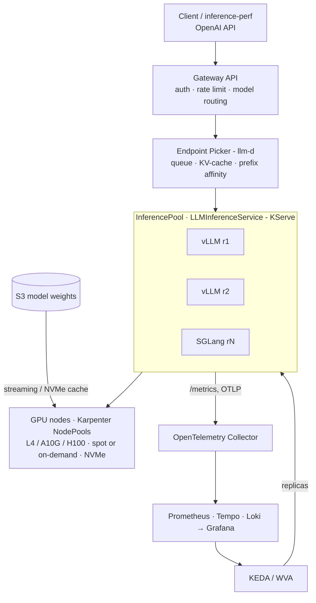

# AIBox — Spec Kit Playbook for Claude Code

> **AIBox — AI Platform in a Box.** A reference LLM inference platform on Kubernetes that comes up with one command and ships a reproducible benchmark report: cost per 1M tokens, p99 TTFT, and the measured effect of every architecture decision.

This document is written **for Claude Code** and executed by it end to end, without human interaction. The human maintainer reviews the resulting pull requests afterwards.

---

## 0. For the human (read once, 2 minutes)

**Prerequisites on your Mac:** Homebrew, a GitHub account, and `gh auth login` already done (scopes: `repo`, `workflow`, `read:org`). Claude Code installed.

**Start the run** from the folder where you keep code (the playbook will create `./aibox`):

```bash
mkdir -p ~/code && cd ~/code
cp "/path/to/aibox-speckit-playbook.md" ./aibox-speckit-playbook.md

# Hide AWS credentials from the agent: it must never create cloud resources unattended.
env -u AWS_PROFILE -u AWS_ACCESS_KEY_ID -u AWS_SECRET_ACCESS_KEY -u AWS_SESSION_TOKEN \
  AWS_CONFIG_FILE=/dev/null AWS_SHARED_CREDENTIALS_FILE=/dev/null \
  claude --permission-mode acceptEdits
```

Then paste this single prompt:

```text
Read ./aibox-speckit-playbook.md completely and execute it end to end, autonomously.
Do not ask me questions; follow the playbook's decision rules and record every decision.
Stop only when every feature in Section 6 has an open pull request, or when a hard stop
in Section 2 applies.
```

If the session ends early (context or time limit), start a new session in `~/code/aibox` with:

```text
Read docs/agent/PLAYBOOK.md and docs/agent/PROGRESS.md, then resume from the next unfinished step.
```

**Reviewing afterwards:** PRs are **stacked** (each feature branches from the previous one). Review and merge **bottom-up** in the order listed in the tracking issue "v1.0 roadmap". When a PR is merged with "delete branch", GitHub retargets the next PR to `main` automatically.

**What the agent will NOT do:** run anything against AWS (`terraform apply`, `aws ...`, `make up PROFILE=aws-*`), merge PRs, push to `main` after the bootstrap commit, or change repository visibility. Cloud runs (M1 gate on AWS, benchmark rounds) are yours, guided by runbooks the agent writes.

---

## 1. Mission and inputs for the agent

You are the sole engineer building **AIBox**, an open-source reference platform for serving LLMs on Kubernetes. The product specification is **Appendix A** (copy it into the repo as `docs/product/spec.md`). The project constitution is **Appendix B**. The feature backlog is **Section 6**, in dependency order.

Your outputs are: a public GitHub repository with open-source best practices, one Spec Kit feature per backlog item, and one pull request per feature (plus follow-up PRs per iteration), each green in CI and ready for review.

---

## 2. Operating rules (non-negotiable)

### 2.1 Autonomy and decisions

1. **Never wait for the human.** When a Spec Kit step asks questions (e.g. `/speckit-clarify`), answer them yourself using Appendix A, the constitution and the product's goals. Prefer the option that keeps the `local` profile working, is simplest, and is easiest to measure.
2. **Record every decision** you make on the human's behalf:
   - in the feature's `spec.md` under `## Clarifications` (format: `- Q: … → A: … (decided by agent: <one-line rationale>)`);
   - as an ADR in `docs/adr/` when the decision is architectural (Section 6 names the expected ADRs);
   - in the PR description under **"Decisions for the reviewer"**.
3. **Blocked?** If a task truly cannot be completed (missing credential, upstream bug, unavailable artifact), do not stop the run: open an issue labeled `needs-human` describing the blocker and the options, reference it in the PR, mark the affected tasks `[~]` with a link in `tasks.md`, and continue with the next feature.
4. **Versions:** resolve the **latest stable** release of every tool, chart, image and module at implementation time, then **pin** it (lock files, chart versions, image digests, action SHAs). Never use `latest` tags.
5. **Verify upstream APIs** before writing manifests for fast-moving projects (llm-d, Gateway API Inference Extension, KServe `LLMInferenceService`, Workload Variant Autoscaler, Karpenter). Read the docs or the CRDs of the pinned version; do not rely on memory. Cite the doc URL in the plan's `research.md`.

### 2.2 Hard stops — never do these

- No command that creates, changes or deletes cloud resources or costs money: `terraform apply|destroy`, `tofu apply|destroy`, any mutating `aws` CLI call, `make up|down PROFILE=aws-*`, `eksctl create`. Terraform work is validated with `fmt`, `validate`, `tflint`, `trivy config` and `terraform test` using mock providers only.
- No push to `main` after the bootstrap commit (Section 4). No force-push to `main`. Force-push to your own feature branches only with `--force-with-lease`.
- No merging PRs, no approving PRs, no changing repo visibility, no deleting the repo, no editing other repositories.
- No secrets in git. No real API keys, tokens or account IDs in code, tests or docs.
- No disabling of CI checks, linters or tests to get green. Fix the cause or open a `needs-human` issue.

### 2.3 Session continuity

Maintain `docs/agent/PROGRESS.md` on every branch you create, updated after every step: current feature, current Spec Kit phase, last commit, open PRs in merge order, blockers. A fresh session must be able to resume from it alone. Also keep the "v1.0 roadmap" tracking issue updated (checklist of PRs in merge order).

---

## 3. Prerequisites check (Step 1)

Run and install anything missing with Homebrew (`brew install …`) or `uv`:

| Tool | Check | Install |
| --- | --- | --- |
| git ≥ 2.40 | `git --version` | `brew install git` |
| GitHub CLI, authenticated | `gh auth status` | `brew install gh` — if not authenticated, **hard stop** and tell the human |
| uv + Python ≥ 3.11 | `uv --version` | `brew install uv` |
| Spec Kit CLI | `specify version` | `uv tool install specify-cli --from git+https://github.com/github/spec-kit.git@<latest tag>` (get the tag with `gh release view -R github/spec-kit --json tagName -q .tagName`) |
| Go (latest stable) | `go version` | `brew install go` |
| Docker runtime | `docker info` | Docker Desktop or `brew install colima docker && colima start --cpu 6 --memory 12` |
| kind, kubectl, helm, kustomize | `kind version` … | `brew install kind kubectl helm kustomize` |
| Terraform or OpenTofu | `terraform version` | `brew install opentofu` (use `tofu`; keep code Terraform-compatible) |
| Linters | — | `brew install golangci-lint tflint trivy actionlint shellcheck yamllint markdownlint-cli2 pre-commit kubeconform chart-testing` |
| Argo CD CLI, k6 (optional) | — | `brew install argocd` |

Record versions in `docs/agent/PROGRESS.md`.

---

## 4. Repository bootstrap (Step 2)

### 4.1 Name and identity

| Field | Value |
| --- | --- |
| Repository | `aibox` under the authenticated user (`OWNER=$(gh api user -q .login)`) |
| Display name | AIBox — AI Platform in a Box |
| Description | `Reference LLM inference platform on Kubernetes — vLLM/SGLang, llm-d, KServe, KEDA, Karpenter, OpenTelemetry — with reproducible cost-per-token and latency benchmarks.` |
| Topics | `kubernetes`, `llm`, `llm-inference`, `vllm`, `sglang`, `llm-d`, `kserve`, `keda`, `karpenter`, `gateway-api`, `opentelemetry`, `grafana`, `gpu`, `platform-engineering`, `benchmark`, `mlops` |
| License | Apache-2.0 |
| Go module | `github.com/$OWNER/aibox` |
| Visibility | Public |
| Default branch | `main` |

### 4.2 Local repo + Spec Kit

```bash
mkdir aibox && cd aibox
git init -b main
specify init --here --integration claude --non-interactive --force
# Ensure the git extension (feature branches NNN-short-name) is enabled:
specify extension list            # if "git" is absent or disabled:
specify extension add git || specify extension enable git
```

Confirm skills exist in `.claude/skills/speckit-*/SKILL.md` (commands are invoked as `/speckit-constitution`, `/speckit-specify`, …). If the installed version uses another invocation form (e.g. `/speckit.specify`), use that form everywhere this playbook says `/speckit-<name>`. Set `branch_numbering: sequential` in the git extension config if it is configurable.

### 4.3 Bootstrap commit (the only direct commit to `main`)

Create exactly these files, then commit:

- `LICENSE` (Apache-2.0 full text, copyright `The AIBox Authors`), `NOTICE`.
- `README.md` stub: name, one-paragraph pitch, "🚧 under construction — see the roadmap issue", license badge.
- `.gitignore` (Go, Python, Terraform, macOS, IDE, `.env*`, `*.tfstate*`, `bench/results/**/raw/` large files), `.gitattributes` (`* text=auto eol=lf`), `.editorconfig`.
- `CLAUDE.md` — agent rules for this repo: a condensed copy of Section 2 + the workflow loop of Section 5 + "read `docs/agent/PROGRESS.md` first".
- `.claude/settings.json` — shared permissions (see 4.5).
- `docs/agent/PLAYBOOK.md` — this file, verbatim.
- `docs/agent/PROGRESS.md` — initial state.
- `docs/product/spec.md` — Appendix A, verbatim.
- Spec Kit scaffold produced by `specify init` (`.specify/`, `.claude/skills/`).
- `.specify/memory/constitution.md` — produced by running `/speckit-constitution` with Appendix B as input. Version it `1.0.0`.

```bash
git add -A
git commit -s -m "chore: bootstrap repository with Spec Kit, constitution and product spec"
```

### 4.4 Create the GitHub repository and configure it

```bash
OWNER=$(gh api user -q .login)
gh repo create aibox --public --source . --remote origin --push \
  --description "Reference LLM inference platform on Kubernetes — vLLM/SGLang, llm-d, KServe, KEDA, Karpenter, OpenTelemetry — with reproducible cost-per-token and latency benchmarks."

gh repo edit "$OWNER/aibox" \
  --enable-issues --enable-discussions --enable-wiki=false --enable-projects=false \
  --enable-squash-merge --enable-merge-commit=false --enable-rebase-merge=false \
  --delete-branch-on-merge --enable-auto-merge \
  --add-topic kubernetes,llm,llm-inference,vllm,sglang,llm-d,kserve,keda,karpenter,gateway-api,opentelemetry,grafana,gpu,platform-engineering,benchmark,mlops

# Security features
gh api -X PUT  "repos/$OWNER/aibox/vulnerability-alerts"
gh api -X PUT  "repos/$OWNER/aibox/automated-security-fixes"
gh api -X PUT  "repos/$OWNER/aibox/private-vulnerability-reporting"
gh api -X PATCH "repos/$OWNER/aibox" --input - <<'JSON'
{"security_and_analysis":{"secret_scanning":{"status":"enabled"},"secret_scanning_push_protection":{"status":"enabled"}}}
JSON
```

**Ruleset for `main`** (save as `.github/rulesets/main.json` in feature 001 too, so it is reviewable as code):

```json
{
  "name": "main",
  "target": "branch",
  "enforcement": "active",
  "conditions": { "ref_name": { "include": ["~DEFAULT_BRANCH"], "exclude": [] } },
  "bypass_actors": [ { "actor_id": 5, "actor_type": "RepositoryRole", "bypass_mode": "pull_request" } ],
  "rules": [
    { "type": "deletion" },
    { "type": "non_fast_forward" },
    { "type": "required_linear_history" },
    { "type": "pull_request", "parameters": {
        "required_approving_review_count": 0,
        "dismiss_stale_reviews_on_push": true,
        "require_code_owner_review": false,
        "require_last_push_approval": false,
        "required_review_thread_resolution": true,
        "allowed_merge_methods": ["squash"] } },
    { "type": "required_status_checks", "parameters": {
        "strict_required_status_checks_policy": false,
        "required_status_checks": [ { "context": "ci-gate" } ] } }
  ]
}
```

```bash
gh api -X POST "repos/$OWNER/aibox/rulesets" --input .github/rulesets/main.json
```

If the API rejects a field, remove only that field, retry, and note it in `PROGRESS.md`. The `ci-gate` check is introduced by feature 001; every PR after it reports it.

**Labels** (delete GitHub defaults that overlap, then create):

| Label | Color | Use |
| --- | --- | --- |
| `kind/feature`, `kind/bug`, `kind/docs`, `kind/chore`, `kind/refactor`, `kind/test` | `1d76db` | Change type |
| `area/cli`, `area/infra`, `area/gpu`, `area/models`, `area/serving`, `area/gateway`, `area/routing`, `area/autoscaling`, `area/observability`, `area/cost`, `area/benchmark`, `area/report`, `area/docs`, `area/ci` | `c5def5` | Component |
| `spec` | `5319e7` | PR or issue touching Spec Kit artifacts |
| `constitution` | `b60205` | Changes to the constitution |
| `needs-human` | `d93f0b` | Blocked on the maintainer (credentials, cloud runs, decisions) |
| `stacked` | `fbca04` | PR based on another unmerged PR |
| `good first issue`, `help wanted` | defaults | Community |
| `dependencies` | `0366d6` | Dependabot |

**Milestones:** `M0 Foundation`, `M1 First token`, `M2 Observability`, `M3 Routing + autoscaling`, `M4 Benchmark harness`, `M5 Report v1.0`.

**Tracking issue:** "v1.0 roadmap" — pinned, with a checklist of all 16 features (Section 6) grouped by milestone. Each item will link its PR. Keep the section "Merge order" at the top.

### 4.5 Claude Code project permissions (`.claude/settings.json`)

```json
{
  "permissions": {
    "allow": [
      "Bash(git:*)", "Bash(gh:*)", "Bash(specify:*)", "Bash(uv:*)", "Bash(go:*)",
      "Bash(make:*)", "Bash(kind:*)", "Bash(kubectl:*)", "Bash(helm:*)", "Bash(kustomize:*)",
      "Bash(docker:*)", "Bash(tofu fmt:*)", "Bash(tofu validate:*)", "Bash(tofu init:*)", "Bash(tofu test:*)",
      "Bash(terraform fmt:*)", "Bash(terraform validate:*)", "Bash(terraform init:*)", "Bash(terraform test:*)",
      "Bash(tflint:*)", "Bash(trivy:*)", "Bash(golangci-lint:*)", "Bash(actionlint:*)", "Bash(shellcheck:*)",
      "Bash(yamllint:*)", "Bash(markdownlint-cli2:*)", "Bash(pre-commit:*)", "Bash(kubeconform:*)", "Bash(ct:*)",
      "Bash(argocd:*)", "Bash(python:*)", "Bash(python3:*)", "Bash(curl:*)", "Bash(jq:*)", "Bash(yq:*)",
      "Bash(ls:*)", "Bash(cat:*)", "Bash(mkdir:*)", "Bash(cp:*)", "Bash(mv:*)", "Bash(rm:*)", "Bash(brew install:*)"
    ],
    "deny": [
      "Bash(terraform apply:*)", "Bash(terraform destroy:*)", "Bash(tofu apply:*)", "Bash(tofu destroy:*)",
      "Bash(aws:*)", "Bash(eksctl:*)", "Bash(make up PROFILE=aws:*)", "Bash(make down PROFILE=aws:*)",
      "Bash(gh pr merge:*)", "Bash(gh pr review:*)", "Bash(gh repo delete:*)", "Bash(gh repo edit --visibility:*)",
      "Bash(git push origin main:*)", "Bash(git push -f origin main:*)", "Bash(git push --force origin main:*)"
    ]
  }
}
```

Note: Claude Code matches `Bash(...)` rules by command prefix. Commands in the `make` allow-list that would touch AWS are additionally blocked by the deny list and by the absence of AWS credentials in the session.

---

## 5. The feature loop (Step 3, repeated for every feature in Section 6)

### 5.1 Branching model: stacked feature branches

Because the maintainer reviews later, feature `N` is built **on top of** feature `N-1`:

```text
main ← 001-repo-foundation ← 002-cli-skeleton ← 003-local-platform ← … ← 016-docs-release
```

- Before starting feature `N`: `git checkout <branch of N-1>` (or `main` for 001), make sure it is pushed, then run `/speckit-specify` — the git extension creates `NNN-short-name` from the current `HEAD`.
- The PR for feature `N` uses `--base <branch of N-1>` and the label `stacked` (not for 001).
- **Iterations** on a feature (review feedback, convergence gaps found later, follow-ups) use a new branch named `NNN-short-name-iterK` from the feature branch, and a PR whose base is the feature branch. Keep Spec Kit's numeric prefix so its scripts still resolve the feature directory.
- After the maintainer merges lower PRs, rebase the rest of the stack with `git rebase --update-refs main` from the top branch and push each branch with `--force-with-lease`.

### 5.2 Steps per feature

| # | Step | Output | Commit message |
| --- | --- | --- | --- |
| 1 | `git checkout <base>`; `/speckit-specify` with the feature's **Specify input** (Section 6) | Branch `NNN-short-name`, `specs/NNN-short-name/spec.md`, `checklists/requirements.md` | `docs(spec): specify NNN <feature>` |
| 2 | `/speckit-clarify` — answer every question yourself (rule 2.1.1–2) | `spec.md` with `## Clarifications` | `docs(spec): clarify NNN` |
| 3 | `/speckit-plan` with the feature's **Plan input** | `plan.md`, `research.md`, `data-model.md`, `contracts/`, `quickstart.md` as applicable | `docs(plan): plan NNN` |
| 4 | `/speckit-checklist` (requirements quality: completeness, testability, security, cost-safety). Tick items only when the spec/plan satisfies them; fix the spec otherwise | `checklists/*.md` | `docs(spec): checklist NNN` |
| 5 | `/speckit-tasks` | `tasks.md` | `docs(tasks): tasks NNN` |
| 6 | `/speckit-analyze`; fix every CRITICAL/HIGH finding in the artifacts, then re-run until clean | (report only) | `docs(spec): resolve analysis findings NNN` |
| 7 | Push branch; open a **draft PR** now (so the plan is reviewable even if implementation stalls) | Draft PR | — |
| 8 | `/speckit-implement`, phase by phase. Commit after each phase. Tests before implementation where the plan says so | Code, tests, docs | Conventional Commits, e.g. `feat(cli): add profile loader` |
| 9 | Local verification: `make lint test` + the feature's **Definition of done** commands | All green | `fix(...)`/`test(...)` as needed |
| 10 | `/speckit-converge`; implement any gap tasks it appends, repeat until it appends none | Updated `tasks.md` | `fix(...)` |
| 11 | Update docs touched by the feature (README sections, `docs/`, runbooks, ADRs), `CHANGELOG` is generated by release-please — do not edit it | Docs | `docs(...)` |
| 12 | Push; wait for CI (`gh pr checks --watch`); fix until green; mark **ready for review**; update tracking issue + `PROGRESS.md` | Ready PR | — |

### 5.3 Pull request conventions

- **Title:** Conventional Commit form, e.g. `feat(gateway): OpenAI-compatible gateway with API keys and rate limits (#009)`.
- **Body** (from `.github/PULL_REQUEST_TEMPLATE.md`, created in 001):
  - Summary (2–4 lines) and link to `specs/NNN-*/spec.md`
  - Stack: "Based on #(PR of N-1); merge after it"
  - Requirements covered (FR/NFR IDs from Appendix A)
  - Decisions for the reviewer (every agent decision, with rationale)
  - How it was verified (commands and results)
  - What was not verified (e.g. "requires AWS — see runbook X")
  - Checklist: tests, docs, ADR, no secrets, versions pinned
- **Labels:** `kind/*`, `area/*`, `spec`, `stacked`; milestone; assignee = `$OWNER`; reviewer = `$OWNER` (`gh pr edit --add-reviewer` fails on own PRs — ignore that error).
- **Size:** aim for < 800 changed lines excluding generated files, lock files and Spec Kit artifacts. If a feature is larger, split implementation into iteration PRs per user story (5.1).
- **Commits:** Conventional Commits, signed off (`git commit -s`, DCO). Never squash locally; the maintainer squashes on merge.

---

## 6. Feature backlog

Sixteen features, in build order. Each one is one Spec Kit feature, one branch, one PR (plus iteration PRs if needed).

| # | Branch (short name) | Milestone | Base branch | Main areas |
| --- | --- | --- | --- | --- |
| 001 | `repo-foundation` | M0 | `main` | ci, docs |
| 002 | `cli-skeleton` | M0 | 001 | cli |
| 003 | `local-platform` | M0 | 002 | infra, cli |
| 004 | `aws-infrastructure` | M1 | 003 | infra |
| 005 | `cost-guardrails` | M1 | 004 | cost, cli |
| 006 | `gpu-node-provisioning` | M1 | 005 | gpu, infra |
| 007 | `model-catalog` | M1 | 006 | models |
| 008 | `inference-runtime` | M1 | 007 | serving |
| 009 | `gateway-api` | M1 | 008 | gateway |
| 010 | `observability-stack` | M2 | 009 | observability |
| 011 | `inference-routing` | M3 | 010 | routing |
| 012 | `autoscaling-policies` | M3 | 011 | autoscaling |
| 013 | `benchmark-harness` | M4 | 012 | benchmark |
| 014 | `report-generator` | M4 | 013 | report |
| 015 | `experiment-suite` | M5 | 014 | benchmark, docs |
| 016 | `docs-and-release` | M5 | 015 | docs, ci |

Global plan context (pass to every `/speckit-plan` together with the feature's own Plan input):

```text
Repository conventions: Go (latest stable) for the `aibox` CLI and any small controllers/tools;
Python (latest stable, managed with uv) only for the report generator and analysis;
Terraform-compatible HCL (OpenTofu-tested) for AWS; Kustomize + Helm values for platform
components; Argo CD app-of-apps as the delivery mechanism for everything under platform/.
Every component must have a `local` profile path that runs on kind without GPUs.
Pin every version (go.mod, uv.lock, .terraform.lock.hcl, Helm chart versions, image digests,
GitHub Action SHAs). Follow the repository layout in Appendix A §8 and the constitution.
Never require cloud credentials to build, lint or test.
```

---

### 001 · repo-foundation — Open-source foundation, CI and contributor experience

**Milestone** M0 · **Base** `main` · **ADRs** ADR-0000 "Record architecture decisions" (MADR template)

#### Specify input

```text
Feature: Open-source foundation for the AIBox repository.

Why: AIBox is a public reference project. Contributors and reviewers must find a
repository that follows open-source best practices from day one: clear governance,
security policy, contribution workflow, automated quality gates, and a supply chain
that can be audited.

User stories:
- P1 (Contributor): As a first-time contributor, I can read README, CONTRIBUTING and the
  code of conduct, set up the dev environment with one command (`make dev-setup`), and
  open a PR using a template that tells me what to fill in.
  Acceptance: given a fresh clone on macOS or Linux with Homebrew/apt, when I run
  `make dev-setup && make lint test`, then all checks pass without cloud credentials.
- P1 (Maintainer): As the maintainer, every PR is checked by CI and summarized by a single
  required status check named `ci-gate` that fails if any required job fails.
  Acceptance: a PR with a lint error shows `ci-gate` failing; a clean PR shows it passing.
- P1 (Security reporter): As a security researcher, I find SECURITY.md with a private
  reporting channel (GitHub private vulnerability reporting) and a response-time target.
- P2 (Maintainer): Releases are automated from Conventional Commits (changelog + tag), and
  release artifacts are signed with provenance.
- P2 (User): The repository shows its health: OpenSSF Scorecard, CI and license badges.

Functional requirements:
- Governance files: CODE_OF_CONDUCT.md (Contributor Covenant 2.1), CONTRIBUTING.md
  (dev setup, Spec Kit workflow, branch/PR conventions, DCO sign-off, Conventional
  Commits), SECURITY.md, SUPPORT.md, GOVERNANCE.md (single-maintainer model, path to
  becoming a maintainer), MAINTAINERS.md, .github/CODEOWNERS.
- Templates: issue forms (bug report, feature request, docs) with config.yml pointing
  questions to Discussions; PULL_REQUEST_TEMPLATE.md with the sections in playbook §5.3.
- Repo-as-code: .github/rulesets/main.json, .github/labels.yml (+ a sync workflow or
  script), docs/adr/0000-record-architecture-decisions.md and an ADR template.
- Markdown lint config disables MD013 (line length) and sets MD024 `siblings_only: true`
  so long tables and repeated per-feature subheadings pass.
- Quality gates in CI (pull_request on any base branch, push to main):
  lint (golangci-lint, actionlint, shellcheck, yamllint, markdownlint, editorconfig),
  Go unit tests with race detector, PR title check (Conventional Commits),
  DCO sign-off check, dependency review, and the aggregating `ci-gate` job.
- Security workflows: CodeQL (Go, Python, Actions), OpenSSF Scorecard (weekly + push to
  main, results uploaded to code scanning), Trivy filesystem/config scan.
- Dependency updates: Dependabot for gomod, pip/uv, github-actions, docker, terraform,
  helm (where supported), grouped weekly, Conventional Commit prefixes.
- Release automation: release-please (Go strategy, CHANGELOG.md) and GoReleaser config
  (darwin/linux, amd64/arm64) with SBOM (syft) and keyless cosign signing; SLSA build
  provenance via GitHub artifact attestations. Release workflow runs only on tags.
- Developer experience: Makefile targets help, dev-setup, lint, fmt, test; .pre-commit-config.yaml
  mirroring CI linters; .golangci.yml; .markdownlint-cli2.yaml; .yamllint.
- All workflows: top-level `permissions: {}` or read-only, least-privilege per job,
  actions pinned by full commit SHA with version comment, concurrency groups, timeouts.

Success criteria:
- A clean clone passes `make lint test` locally and `ci-gate` in CI.
- OpenSSF Scorecard workflow runs successfully (score is not gated in this feature).
- Every file listed above exists and is linked from README or CONTRIBUTING.

Out of scope: application code (CLI comes in 002), Kubernetes manifests, docs site.
Edge cases: contributors on Linux without Homebrew; forks without secrets (CI must pass
without any repository secret).
```

#### Plan input

```text
Use GitHub Actions only. CI layout: .github/workflows/ci.yml (lint, test, pr-title, dco,
dependency-review, ci-gate), codeql.yml, scorecard.yml, release-please.yml, release.yml
(GoReleaser on tag), labels.yml. `ci-gate` uses `needs:` on all required jobs and
`if: always()` with an explicit failure check. Pin actions by SHA (look up current SHAs).
DCO check: implement as a small step that verifies `Signed-off-by` on every PR commit
(no third-party app install). PR title: amannn/action-semantic-pull-request (pinned).
Go module initialized as github.com/<owner>/aibox with an empty `cmd/aibox/main.go`
placeholder so Go jobs have something to lint/test (replaced in 002).
```

#### Definition of done

```bash
make dev-setup && make lint test
actionlint && pre-commit run --all-files
gh pr checks --watch   # ci-gate green
```

---

### 002 · cli-skeleton — `aibox` CLI, profiles and preflight checks

**Milestone** M0 · **Base** 001 · **ADRs** ADR-0008 "CLI in Go with Cobra"

#### Specify input

```text
Feature: The `aibox` command-line interface skeleton.

Why: Every AIBox operation (bring-up, teardown, model sync, smoke tests, benchmarks,
reports, cost) goes through one CLI so the experience is "one command" and the same
logic runs locally, in CI and against the cloud. This feature builds the CLI framework,
profile handling and preflight checks; later features add real subcommands.

User stories:
- P1 (Operator): `aibox --help` lists commands up, down, models, smoke, bench, report,
  cost, doctor, version, with consistent flags (--profile, --output json|text,
  --verbose, --dry-run, --yes).
  Acceptance: unimplemented commands exit with code 2 and a clear "not implemented yet"
  message referencing the roadmap.
- P1 (Operator): `aibox doctor --profile local` checks required tools and versions,
  Docker resources, and reports pass/warn/fail per check with remediation hints;
  `--output json` emits machine-readable results. Exit code non-zero on any fail.
- P1 (Operator): Profiles are YAML files in profiles/ (local.yaml, aws-dev.yaml,
  aws-bench.yaml) validated against a JSON Schema; invalid profiles fail fast with the
  field path and the reason.
- P2 (Operator): `aibox doctor --profile aws-*` checks AWS prerequisites (credentials
  present, region set, GPU service quotas for the instance families in the profile)
  using read-only calls only, and reports "skipped: no credentials" when none exist.
- P2 (Contributor): The Makefile exposes the commands from the product spec
  (make up/down/models-sync/smoke/bench/report/cost) as thin wrappers around the CLI.

Requirements: product spec §5 (commands, profiles), NFR-8 (CI on local profile).
Success criteria: unit test coverage ≥ 80% for packages config/profile and doctor;
`aibox doctor --profile local` passes on the CI runner.
Out of scope: actually creating clusters (003, 004).
Edge cases: missing Docker daemon; profile file not found; unknown profile keys;
running on Linux arm64.
```

#### Plan input

```text
Go + Cobra + Viper-free config (plain YAML via sigs.k8s.io/yaml + JSON Schema validation
with santhosh-tekuri/jsonschema). Packages: cmd/aibox, internal/cli, internal/profile,
internal/doctor, internal/exec (command runner with dry-run and recorded fakes for
tests), internal/output (text/json). Structured logging with log/slog. Version info
injected by GoReleaser ldflags. AWS read-only checks via aws-sdk-go-v2 (service-quotas,
sts GetCallerIdentity) behind an interface, mocked in tests. Golden-file tests for help
output and doctor JSON.
```

#### Definition of done

```bash
go test ./... -race -cover
go run ./cmd/aibox doctor --profile local --output json | jq .
go run ./cmd/aibox up --profile local; test $? -eq 2
```

---

### 003 · local-platform — `local` profile on kind with GitOps bootstrap

**Milestone** M0 · **Base** 002 · **ADRs** ADR-0009 "GitOps with Argo CD app-of-apps"

#### Specify input

```text
Feature: One-command local platform (`aibox up --profile local`) on kind, without GPUs.

Why: The whole platform must be developable, demoable and testable in CI at zero cost.
The local profile replaces GPUs with the llm-d inference simulator (an OpenAI-compatible
fake model server that emits realistic vLLM-style metrics) so routing, autoscaling and
observability can be exercised on a laptop.

User stories:
- P1 (Developer): `aibox up --profile local` creates a kind cluster (name aibox-local),
  installs Argo CD, applies the app-of-apps from platform/ for the local overlay, waits
  until all Argo CD Applications are Synced/Healthy, and prints endpoints.
  Acceptance: completes in ≤ 10 minutes on a 4-CPU/8-GB CI runner; re-running is
  idempotent; `aibox down --profile local` deletes the cluster.
- P1 (Developer): A sample model "sim-llama-8b" served by the inference simulator answers
  `POST /v1/chat/completions` through a port-forward or local ingress.
- P1 (Maintainer): CI job `e2e-local` runs up → smoke → down on every PR and is required
  by `ci-gate`.
- P2 (Developer): Argo CD watches the current git branch for local development
  (configurable), or applies from the working tree for fast iteration (`--from-worktree`).

Requirements: product spec §5 profiles (local), NFR-8.
Success criteria: e2e-local green in CI; one documented quickstart in README
("5-minute local quickstart").
Out of scope: gateway, autoscaling and observability components (later features add
their local overlays); real GPUs.
Edge cases: kind cluster already exists; Docker with low memory; Apple Silicon (arm64
images required for every local component).
```

#### Plan input

```text
platform/ layout per Appendix A §8 with Kustomize bases + overlays/{local,aws}. Argo CD
installed by the CLI via Helm (pinned chart), then a root Application pointing to
platform/bootstrap/<profile>. Use sync waves for ordering (CRDs → operators → workloads).
Inference simulator: llm-d-inference-sim (verify image name, flags and metrics in its
README for the pinned version). CLI waits on Argo CD Application health via the
Kubernetes API (client-go dynamic client), not by shelling out to argocd.
e2e test written in Go (test/e2e) using the CLI as a library; CI uses helm/kind-action
pinned by SHA or installs kind directly.
```

#### Definition of done

```bash
go run ./cmd/aibox up --profile local
go run ./cmd/aibox smoke --profile local
go run ./cmd/aibox down --profile local
```

---

### 004 · aws-infrastructure — Terraform for VPC, EKS, IAM and storage

**Milestone** M1 · **Base** 003 · **ADRs** ADR-0001 "EKS + Karpenter as the reference substrate (GKE deferred to v2)"

#### Specify input

```text
Feature: AWS infrastructure as code for the aws-dev and aws-bench profiles.

Why: The cloud profiles need a reproducible, least-privilege EKS environment created and
destroyed by one command, with everything tagged for cost tracking and orphan detection.

User stories:
- P1 (Operator): `aibox up --profile aws-dev` runs Terraform to create VPC (3 AZs,
  private subnets for nodes, public for load balancers), EKS (latest supported version),
  a small on-demand CPU system node group, EKS Pod Identity associations, S3 bucket for
  model weights (versioning on, encryption on, public access blocked), and outputs the
  values the GitOps layer needs.
  Acceptance (human-run, documented in a runbook): bring-up to "cluster reachable" in
  ≤ 20 minutes; `aibox down` destroys everything.
- P1 (Maintainer): Terraform code passes fmt, validate, tflint (AWS ruleset) and trivy
  config scanning in CI, plus `terraform test` with mock providers covering variable
  validation and key resource attributes (encryption, tags, IAM scoping).
- P1 (Operator): All resources carry tags project=aibox, run-id, owner, profile.
- P2 (Operator): Remote state in an S3 backend with native locking, created by a
  separate bootstrap stack (documented, human-run once).

Requirements: FR-INF-1, NFR-3, NFR-6; tags used by 005.
Success criteria: CI validates Terraform without AWS credentials; a runbook
docs/runbooks/aws-first-run.md explains quotas, region choice and the first run.
Out of scope: GPU node pools (006), budgets/TTL (005), multi-region.
Edge cases: region without the GPU families in the profile → fail in `aibox doctor`
before any apply.
```

#### Plan input

```text
infra/terraform/aws/ with modules network, eks, iam, storage and a root per profile
(or one root with profile tfvars). Prefer terraform-aws-modules/vpc and /eks (pinned)
over hand-rolled resources. IAM for Karpenter, KEDA (if it needs AWS), OTel, External
Secrets via EKS Pod Identity. Output a JSON consumed by the CLI to render platform
overlay values (cluster name, OIDC, bucket, role ARNs) into a generated, git-ignored
file — never commit account-specific values. CLI `up` for aws profiles shells out to
tofu/terraform via internal/exec; in this feature implement and unit-test that path with
the fake runner only. Agent must not run apply (playbook §2.2).
```

#### Definition of done

```bash
cd infra/terraform/aws && tofu init -backend=false && tofu validate && tofu test
tflint --recursive && trivy config infra/terraform
go test ./internal/... -run 'TestUp.*AWS' -race
```

---

### 005 · cost-guardrails — Budgets, TTL auto-teardown, orphan detection and `aibox cost`

**Milestone** M1 · **Base** 004 · **ADRs** ADR-0010 "Mandatory budget and TTL for cloud runs"

#### Specify input

```text
Feature: Cost guardrails so that no AIBox cloud run can silently keep spending money.

Why: GPU clusters cost tens of dollars per hour. The project promises "one command up,
one command down, nothing left billing". This feature enforces it.

User stories:
- P1 (Operator): `aibox up --profile aws-*` refuses to start without BUDGET_USD (or
  --budget) and TTL (default 4h); it creates an AWS Budget scoped by the run-id tag with
  alerts at 50/80/100% to the operator email from the profile.
- P1 (Operator): A TTL teardown runs automatically when the TTL expires unless renewed
  with `aibox ttl extend 2h`. The teardown must work even if the operator's laptop is
  off (runs in AWS, e.g. EventBridge Scheduler → Lambda/CodeBuild running the
  teardown, or an in-cluster CronJob plus an out-of-cluster fallback — decide in plan).
- P1 (Operator): `aibox down` finishes with an orphan check that lists any resource still
  tagged with the run-id (EBS volumes, ENIs, load balancers, EIPs, snapshots, NAT
  gateways, EC2 instances) and exits non-zero if any remain.
- P1 (Operator): `aibox cost` shows accumulated cost of the current run: instance-hours
  × on-demand/spot price per instance type, plus a note that Cost Explorer data lags.
- P2 (Operator): `aibox doctor` estimates the cost of a planned run from the profile and
  a versioned price table (data/pricing/aws-<region>.yaml) with a "last updated" date.

Requirements: §5 guardrails, NFR-6, FR-OBS-6 (price table reused by observability).
Success criteria: unit tests for budget/TTL rendering, orphan detection against
recorded API fixtures; runbook docs/runbooks/cost-guardrails.md.
Out of scope: real-time Grafana cost panels (010).
Edge cases: teardown while Terraform state is locked; partial apply failures; spot
instances already reclaimed.
```

#### Plan input

```text
Budgets and scheduler resources live in Terraform (module cost-guardrails), created
first and destroyed last. Teardown executor: choose the simplest reliable option that
does not depend on the laptop; document trade-offs in ADR-0010. Orphan checker in Go
using the Resource Groups Tagging API + per-service describe calls (read-only), behind
interfaces with JSON fixtures in testdata/. Price table: YAML with source URL and date;
a script (not run in CI) can refresh it via the AWS Price List API.
```

#### Definition of done

```bash
go test ./internal/cost/... ./internal/teardown/... -race -cover
cd infra/terraform/aws && tofu validate && tofu test
```

---

### 006 · gpu-node-provisioning — Karpenter GPU NodePools, GPU operator and DCGM

**Milestone** M1 · **Base** 005 · **ADRs** none new (extends ADR-0001)

#### Specify input

```text
Feature: Just-in-time GPU nodes with Karpenter and GPU telemetry.

Why: GPU capacity is the dominant cost. Nodes must appear only when inference pods need
them, be the right family, and expose GPU metrics for the cost and utilization analysis.

User stories:
- P1 (Operator): One Karpenter NodePool per GPU class — gpu-l4 (g6), gpu-a10g (g5),
  gpu-h100 (p5, used only with an EC2 Capacity Block reservation) — tainted
  nvidia.com/gpu:NoSchedule, labeled with aibox.dev/gpu-class, with GPU and vCPU limits
  per pool and capacity type (spot/on-demand) selectable per profile.
- P1 (Operator): Consolidation for GPU pools is WhenEmpty with configurable
  consolidateAfter, so pods holding warm KV-cache are not evicted for bin-packing.
- P1 (Operator): EC2NodeClass uses an NVIDIA-enabled AMI family (Bottlerocket NVIDIA or
  AL2023 accelerated — decide in plan) and mounts local NVMe for model weight cache.
- P1 (Operator): GPU resources (nvidia.com/gpu) and DCGM metrics are available; DCGM
  exporter is scraped by the observability stack.
- P2 (Operator): The H100 pool targets a Capacity Block reservation ID from the profile
  and refuses to schedule otherwise.
- P2 (Operator): Scale-to-zero of GPU pools when no GPU pods exist; time from pending
  pod to node Ready is recorded as Kubernetes events/annotations for FR-AS-6.

Requirements: FR-INF-2…7.
Local profile: no Karpenter; provide a local overlay with a fake "gpu" label/taint on a
kind worker so scheduling rules are testable.
Success criteria: manifests validate with kubeconform against the pinned CRD schemas;
a unit/integration test asserts tolerations/affinities of serving pods match pools.
Out of scope: actually launching GPU nodes (human-run, runbook docs/runbooks/gpu-nodes.md).
Edge cases: spot interruption handling (Karpenter interruption queue), quota exhaustion.
```

#### Plan input

```text
Karpenter installed via its Helm chart (pinned) in platform/karpenter with NodePools and
EC2NodeClasses per profile overlay. NVIDIA GPU Operator vs device-plugin + dcgm-exporter:
pick based on the AMI choice (driver preinstalled → device plugin + DCGM exporter only).
Capacity Block support: verify the current Karpenter API for capacity reservations in the
pinned version. kubeconform with CRD schemas extracted from the pinned charts (store
schemas under hack/schemas, generated by a script).
```

#### Definition of done

```bash
make validate-manifests   # kustomize build | kubeconform for local and aws overlays
go run ./cmd/aibox up --profile local && kubectl get nodes -L aibox.dev/gpu-class
```

---

### 007 · model-catalog — Declarative model catalog, weight mirroring and fast loading

**Milestone** M1 · **Base** 006 · **ADRs** ADR-0007 "Weight loading and cold start" (initial decision; confirmed by E7)

#### Specify input

```text
Feature: Model catalog and model weight lifecycle.

Why: Cold start (node + image + weights + warm-up) dominates scale-out time. Models must
be declared once, pinned by revision, mirrored to the environment's own storage, and
loaded fast.

User stories:
- P1 (Operator): models/catalog.yaml declares each model: id, source (HF repo), revision
  (commit SHA), license, quantization, tensor parallel size, max-model-len, minimum GPU
  class, runtime (vllm|sglang), runtime flags, SLO targets (TTFT p99, ITL p99).
  A JSON Schema validates it in CI; `aibox models list` prints it.
- P1 (Operator): `aibox models sync --profile aws-*` runs an in-cluster Job that mirrors
  weights from Hugging Face to the S3 bucket (checksums verified, idempotent, resumable).
  The HF token comes from AWS Secrets Manager via External Secrets — never from git.
- P1 (Operator): Serving pods load weights either by streaming from S3 (Run:ai Model
  Streamer or the runtime's native equivalent) or from the node's NVMe cache; the method
  is a per-model setting so E7 can compare them.
- P2 (Operator): Local profile uses tiny models (or the simulator) and an in-cluster
  MinIO standing in for S3 so the sync path is testable in CI.

Default catalog (v1.0): Llama 3.1 8B Instruct (baseline; license acceptance required),
Qwen 2.5/3 32B (TP=2), one 70B-class model quantized FP8 or AWQ (multi-GPU test).
Prefer Apache-2.0 licensed models as defaults; Llama optional.
Requirements: FR-MOD-1…4, NFR-11.
Success criteria: e2e-local syncs a tiny model to MinIO and a pod loads it.
Out of scope: model quality evaluation, LoRA adapters (v2).
Edge cases: gated models without license acceptance; revision no longer available;
partial uploads.
```

#### Plan input

```text
Catalog schema in schemas/catalog.schema.json; Go types generated or hand-written with
validation tests. Sync Job image: a small pinned image with huggingface_hub CLI and
s5cmd (or the AWS CLI) — no custom image unless necessary. External Secrets Operator
(pinned chart) with a SecretStore for AWS Secrets Manager (aws overlay) and a fake/local
provider for the local overlay. Verify Run:ai Model Streamer support and flags in the
pinned vLLM and KServe versions (KServe can skip storageInitializer).
```

#### Definition of done

```bash
go test ./internal/models/... -race
go run ./cmd/aibox models list --output json | jq .
make e2e-local   # includes model sync to MinIO
```

---

### 008 · inference-runtime — vLLM and SGLang served via KServe LLMInferenceService

**Milestone** M1 · **Base** 007 · **ADRs** ADR-0002 "KServe LLMInferenceService vs raw llm-d Helm charts"

#### Specify input

```text
Feature: Inference runtimes for catalog models.

Why: The runtime is where tokens are produced. AIBox standardizes on vLLM, keeps SGLang
as a comparable alternative, and exposes the same OpenAI-compatible API and metrics for
both so experiments can swap them.

User stories:
- P1 (Operator): For each catalog model, a KServe LLMInferenceService (or equivalent
  per ADR-0002) is rendered from the catalog: runtime image pinned by digest, flags
  (prefix caching, chunked prefill, gpu-memory-utilization, max-num-seqs, kv-cache dtype),
  resources, GPU class affinity/tolerations, and probes.
- P1 (Operator): Readiness turns green only after weights are loaded and a warm-up
  request succeeds; liveness does not kill pods during long loads (startupProbe).
- P1 (Operator): Graceful shutdown: preStop drains in-flight requests up to a configurable
  terminationGracePeriodSeconds.
- P1 (Operator): Every runtime exposes /metrics (Prometheus) and /health; a contract test
  asserts the metric names AIBox depends on exist (e.g. vllm:num_requests_waiting,
  vllm:kv_cache_usage_perc, TTFT/ITL histograms; SGLang equivalents) — names verified
  against the pinned versions.
- P2 (Operator): `runtime: sglang` in the catalog produces an SGLang deployment with the
  same API surface.
- P2 (Operator): FP8 weights and FP8 KV-cache are catalog options.

Requirements: FR-RT-1…5, FR-GW-4.
Local profile: the inference simulator implements the same API and metric names; the
contract test runs against it in CI.
Success criteria: e2e-local deploys the catalog's local model through the same templates
used for AWS; metric contract test green.
Out of scope: routing and gateway (009, 011), autoscaling (012).
Edge cases: OOM at load (documented in runbook model-load-failures.md), TP > GPUs on node.
```

#### Plan input

```text
Install KServe (pinned, LLMInferenceService support) and its llm-d integration per
ADR-0002; if the raw llm-d Helm path is chosen, keep KServe out entirely — do not run
both. Rendering: the CLI (or a Kustomize generator) turns catalog entries into manifests
under a generated overlay; commit templates, not generated per-account files.
Metric contract test in Go: scrape /metrics, parse with prometheus/common expfmt, assert
required series. Keep a mapping file metrics/runtime-metrics.yaml (vllm and sglang names →
AIBox canonical names) consumed by observability and autoscaling features.
```

#### Definition of done

```bash
make e2e-local
go test ./test/contract/... -run TestRuntimeMetrics
```

---

### 009 · gateway-api — OpenAI-compatible gateway with auth, rate limits and baseline routing

**Milestone** M1 · **Base** 008 · **ADRs** ADR-0003 "Gateway implementation (Envoy Gateway / kgateway / Istio)"

#### Specify input

```text
Feature: Single entry point for inference traffic.

Why: Clients need one stable, OpenAI-compatible endpoint with authentication and rate
limits. The benchmark also needs a "naive" round-robin routing mode as the baseline for
experiment E1.

User stories:
- P1 (Client): POST /v1/chat/completions and /v1/completions and GET /v1/models on one
  hostname; the `model` field in the body selects the backend model.
  Acceptance: unknown model → 404 with an OpenAI-style error body.
- P1 (Operator): API keys (stored as Kubernetes Secrets synced from Secrets Manager on
  AWS) are required; requests without a valid key get 401.
- P1 (Operator): Per-key rate limits in requests/min and tokens/min (token-based limit
  may use prompt length estimate + max_tokens; document the approach).
- P1 (Benchmark): Routing mode `round-robin` (plain Service) is selectable per model by a
  flag without redeploying model servers; mode `epp` is added in 011.
- P2 (Operator): TLS on AWS via the cloud load balancer + ACM; local uses plain HTTP on
  localhost.
- P2 (Operator): Streaming (SSE) works end to end with no buffering.

Requirements: FR-GW-1, FR-GW-3, FR-GW-5, FR-GW-6.
Success criteria: e2e-local tests cover auth, rate limiting (429), model routing,
streaming; `aibox smoke` uses the gateway.
Out of scope: InferencePool/EPP scoring (011), multi-tenant quotas, billing.
Edge cases: very large prompts (body size limits), client disconnect mid-stream
(request must be cancelled upstream).
```

#### Plan input

```text
Gateway API CRDs (pinned standard channel) + the implementation chosen in ADR-0003.
Choose based on: Gateway API Inference Extension conformance for 011, body-based model
routing support, rate limiting features, arm64 images for local, and community adoption.
Configuration as Kustomize in platform/gateway. Tests in Go (test/e2e/gateway_test.go)
using an OpenAI client library against the simulator.
```

#### Definition of done

```bash
make e2e-local
go run ./cmd/aibox smoke --profile local --output json | jq '.checks[] | select(.status!="pass")'
```

---

### 010 · observability-stack — OpenTelemetry, Prometheus, Tempo, Loki, Grafana, alerts and cost metrics

**Milestone** M2 · **Base** 009 · **ADRs** ADR-0011 "Prometheus (kube-prometheus-stack) as metrics backend"

#### Specify input

```text
Feature: Observability as a product feature.

Why: Every claim in the benchmark report must be visible live in dashboards, and every
request must be traceable from gateway to decode. Cost per 1M tokens must be visible in
real time, not only in the offline report.

User stories:
- P1 (Operator): OpenTelemetry Collector (agent DaemonSet + gateway Deployment) collects
  metrics (scraping Prometheus endpoints of runtimes, EPP, gateway, DCGM, KEDA,
  Karpenter), traces (OTLP from gateway and runtimes where supported) and logs.
- P1 (Operator): Backends: Prometheus via kube-prometheus-stack (short retention is
  enough), Tempo for traces, Loki for logs, Grafana with datasources and dashboards
  provisioned from git.
- P1 (Operator): Five dashboards: (a) SLO per model — TTFT, ITL, E2E p50/p95/p99, error
  rate; (b) capacity — queue depth, KV-cache usage, running batch, prefix-cache hit rate;
  (c) GPU — SM utilization, memory, power (DCGM); (d) cost — USD/hour per pool and USD per
  1M tokens; (e) scaling — replicas, nodes, provisioning phase timings.
- P1 (Operator): Alerts as code: TTFT p99 SLO violation (per model target from catalog),
  KV-cache > 90% for 5 min, pods pending > 5 min, GPU node idle > 30 min.
- P1 (Operator): Cost metric: recording rules combine node instance type/capacity type
  labels with the price table from 005 to produce USD/hour per pool and USD per 1M
  output tokens.
- P2 (Operator): Traces show spans gateway → routing decision (chosen endpoint) →
  runtime queue → prefill → decode, where the pinned versions support it; document gaps.

Requirements: FR-OBS-1…6, FR-AS-6 (timings panel).
Success criteria: e2e-local asserts that metrics from the simulator appear in Prometheus,
a trace for a smoke request exists in Tempo, and Grafana dashboards load without errors
(API check). Dashboards lint (e.g. dashboard-linter) in CI.
Out of scope: long-term storage (Mimir/Thanos), SaaS backends.
Edge cases: high-cardinality labels (no per-request labels), missing DCGM on local.
```

#### Plan input

```text
platform/observability with kube-prometheus-stack, tempo, loki (single-binary/monolithic
modes), grafana dashboards as JSON in dashboards/ loaded via sidecar ConfigMaps,
opentelemetry-operator or plain Collector Helm chart (pick simplest). PrometheusRules
for recording/alerting rules with unit tests via `promtool test rules`. Price table from
data/pricing exported to Prometheus via a tiny static exporter or recording rules
generated from YAML (decide in plan; generated rules preferred — no extra service).
Use metrics/runtime-metrics.yaml so dashboards work for both vLLM and SGLang.
```

#### Definition of done

```bash
promtool test rules platform/observability/rules/tests/*.yaml
make e2e-local   # includes observability assertions
```

---

### 011 · inference-routing — InferencePool + llm-d Endpoint Picker with switchable scoring

**Milestone** M3 · **Base** 010 · **ADRs** ADR-0005 "Routing strategy" (initial; confirmed by E1)

#### Specify input

```text
Feature: Inference-aware routing.

Why: LLM requests are not interchangeable: queue depth, KV-cache pressure and prefix-cache
locality decide TTFT. AIBox routes through the Gateway API Inference Extension
(InferencePool + Endpoint Picker from llm-d) and makes the scoring strategy switchable
so experiment E1 can measure each step.

User stories:
- P1 (Operator): Each model is an InferencePool with an EPP; the gateway routes
  `model` → InferencePool via HTTPRoute (or the integration KServe provides).
- P1 (Benchmark): Routing mode per model: `round-robin` (from 009), `epp-load`
  (queue + KV-cache scorers), `epp-prefix` (load + prefix-cache affinity). Switching
  modes is one CLI command (`aibox routing set <model> <mode>`) and does not restart
  model servers.
- P1 (Operator): EPP metrics (decisions, scorer values, pool queue/KV aggregates) are
  scraped and shown on the capacity dashboard; each request's chosen endpoint is visible
  in traces or logs.
- P2 (Operator): Fallback: if the EPP is unavailable, behavior is documented and tested
  (fail-open vs fail-closed per the pinned version's options).

Requirements: FR-GW-2, FR-GW-3, FR-GW-4, FR-OBS-4.
Local profile: the simulator supports prefix-cache and KV-cache simulation (verify) so
e2e-local can show prefix-affinity routing concentrating shared-prefix requests.
Success criteria: e2e-local test sends shared-prefix requests and asserts that
`epp-prefix` sends ≥ 80% of them to the same endpoint while `round-robin` spreads them.
Out of scope: prefill/decode disaggregation, KV-cache offload (v2).
Edge cases: pool with a single replica; replicas becoming not-ready mid-run.
```

#### Plan input

```text
Pin the Gateway API Inference Extension and llm-d inference scheduler versions that the
pinned KServe supports (verify compatibility matrix). Scoring modes implemented as EPP
config profiles (ConfigMaps/plugins config) selected per pool. `aibox routing set` patches
the pool/route via the Kubernetes API with server-side apply and records the change as an
annotation (who/when/mode) for benchmark metadata.
```

#### Definition of done

```bash
make e2e-local
go test ./test/e2e/... -run TestPrefixAffinityRouting
```

---

### 012 · autoscaling-policies — KEDA (queue, KV-cache), HPA baseline, WVA and scale-to-zero

**Milestone** M3 · **Base** 011 · **ADRs** ADR-0004 "Autoscaling signal" (initial; confirmed by E2)

#### Specify input

```text
Feature: Autoscaling policies driven by inference signals.

Why: CPU/GPU utilization is a poor scaling signal for LLM serving; queue depth and
KV-cache pressure track user-visible latency. AIBox ships four comparable policies and
measures them in experiment E2.

User stories:
- P1 (Operator): Policies selectable per model in the catalog (and by CLI for
  experiments): `hpa-utilization` (baseline: standard HPA on GPU/CPU utilization),
  `keda-queue` (vllm:num_requests_waiting, or the pool aggregate), `keda-kvcache`
  (vllm:kv_cache_usage_perc), `wva` (llm-d Workload Variant Autoscaler, using KEDA
  as its actuator where applicable). Each policy declares target, min/max replicas,
  stabilization windows and cooldown, versioned in git.
- P1 (Operator): Scale-to-zero per model (minReplicaCount 0) with activation on queued
  requests at the gateway/EPP; first-request TTFT after idle is recorded.
- P1 (Operator): Scale-out phase timings are recorded: trigger → pod pending → node
  provisioned → image pulled → weights loaded → ready (events/annotations collected by a
  small Go watcher `aibox-scaletimer` or derived from existing events — decide in plan),
  exported as metrics for the scaling dashboard and the benchmark metadata.
- P2 (Operator): Policy switching via `aibox autoscaling set <model> <policy>` without
  redeploying model servers.

Requirements: FR-AS-1…6.
Local profile: simulator metrics drive KEDA; e2e-local generates load and asserts the
replica count increases under `keda-queue` and returns to min after cooldown.
Success criteria: e2e-local scaling test green; promtool tests for any recording rules
used by policies.
Out of scope: cluster-level GPU capacity planning beyond Karpenter limits.
Edge cases: flapping (stabilization), metrics unavailable (KEDA fallback replicas),
WVA and KEDA both targeting the same workload (must be prevented by validation).
```

#### Plan input

```text
KEDA (pinned) with Prometheus scaler; ScaledObjects generated from catalog + policy
definitions in platform/autoscaling/policies/*.yaml. WVA: verify install method,
CRDs and KEDA integration for the version paired with the pinned KServe (KServe 0.18
paired WVA v0.6 with a `keda` block under `scaling.wva`). Validation in the CLI rejects
two policies on one workload. Scale timer in Go using informers on Pods/Nodes/Events with
unit tests on recorded event streams.
```

#### Definition of done

```bash
make e2e-local
go test ./test/e2e/... -run TestKedaQueueScaling
go test ./cmd/aibox-scaletimer/... -race
```

---

### 013 · benchmark-harness — Load generation, workloads, experiment definitions and results schema

**Milestone** M4 · **Base** 012 · **ADRs** ADR-0012 "inference-perf as the load generator"

#### Specify input

```text
Feature: Reproducible benchmark harness.

Why: The benchmark report is AIBox's differentiator. Every number must come from a
declared experiment, run the same way every time, with complete metadata.

User stories:
- P1 (Benchmarker): Workloads are declared in bench/workloads/*.yaml: chat-short
  (~500 in / ~250 out, ShareGPT-like distribution), rag-long (4–8k in, ~300 out,
  shared prefixes), summarize (8–16k in, ~500 out), agentic-multiturn (5–10 turns
  reusing history), burst (0 → 10× in 60 s then back). Datasets are pinned by content
  hash; synthetic generators are seeded.
- P1 (Benchmarker): Experiments are declared in bench/experiments/E*.yaml: the single
  variable, baseline, variants, workloads, load pattern (Poisson rate sweep to
  saturation, or time profile), duration (2 min warm-up discarded + 10 min measure),
  repetitions (3), SLO (from catalog). Adding an experiment requires no code.
- P1 (Benchmarker): `aibox bench run E1 [--variant X] [--profile P]` applies the
  variant (routing/autoscaling/runtime/flags via the CLIs from 011/012), runs the load
  generator as a Kubernetes Job on a dedicated CPU node, collects client-side results
  and server-side metrics snapshots (Prometheus range queries), and writes
  bench/results/<date>-<exp>-<variant>-<rep>/ with results.json, metrics.parquet and
  metadata.json.
- P1 (Benchmarker): metadata.json is complete: repo commit, dirty flag, image digests,
  chart versions, driver/CUDA versions, instance types, AZ, capacity type, runtime
  flags, routing/autoscaling mode, dataset hashes, start/end timestamps, price table
  version. Results without complete metadata are rejected (JSON Schema).
- P2 (Benchmarker): `aibox bench estimate E1 --profile aws-bench` prints the expected
  duration and cost before running.
- P2 (Benchmarker): Cross-check mode runs `vllm bench serve` (or GuideLLM) for one point
  to validate the main load generator.

Requirements: product spec §6 (metrics, workloads, protocol), NFR-1, NFR-2.
Local profile: full harness runs against the simulator in CI with tiny durations
(`--smoke`), producing schema-valid results.
Success criteria: e2e-local runs E1 in smoke mode end to end and validates outputs.
Out of scope: report rendering (014); running real experiments on AWS (human, 015).
Edge cases: load generator saturating itself (detect client-side bottleneck and flag the
run invalid), Prometheus gaps, interrupted runs (resume or mark incomplete).
```

#### Plan input

```text
Load generator: kubernetes-sigs/inference-perf (pinned image) configured from workload +
experiment YAML; verify its config format and output schema for the pinned version.
Results schema in schemas/results.schema.json and schemas/metadata.schema.json.
Prometheus snapshot queries defined in bench/queries.yaml using canonical metric names
from metrics/runtime-metrics.yaml. Store small results in git; large raw files (> 5 MB)
go to Git LFS (configure .gitattributes) — document the choice. Go packages
internal/bench/{workload,experiment,runner,collect}.
```

#### Definition of done

```bash
go test ./internal/bench/... -race -cover
go run ./cmd/aibox bench run E1 --profile local --smoke
check-jsonschema --schemafile schemas/results.schema.json bench/results/*/results.json
```

---

### 014 · report-generator — From raw results to REPORT.md with decisions and charts

**Milestone** M4 · **Base** 013 · **ADRs** ADR-0013 "Report generator in Python"

#### Specify input

```text
Feature: Benchmark report generator.

Why: Readers (hiring managers, platform engineers) need decisions, not raw numbers:
"choose X because it is Y% cheaper per 1M tokens at a p99 TTFT of Z ms".

User stories:
- P1 (Reader): report/REPORT.md is generated by `aibox report` (which calls the Python
  generator) and contains: executive summary table of decisions; one section per
  experiment with hypothesis, configuration, latency–throughput curves, cost per 1M
  tokens at the SLO point, conclusion and link to its ADR; a cumulative waterfall chart
  of cost per 1M tokens from the naive baseline to the final configuration; threats to
  validity; how to reproduce (exact commands + estimated cost).
- P1 (Reader): Cost per 1M tokens follows the product spec formula: sum of GPU node price
  × time over the measured window divided by (output tokens + w × input tokens) × 1e6,
  reported for w = 0 and for a calibrated w, plus the 100%-utilization theoretical floor.
- P1 (Reader): Medians with min–max (or 95% CI) across repetitions; goodput (requests/s
  meeting both TTFT and ITL SLOs) is the primary throughput number.
- P1 (Maintainer): The generator refuses results with incomplete metadata and is
  deterministic (same inputs → byte-identical Markdown and charts).
- P2 (Reader): Charts are SVG with accessible titles; the report renders well on GitHub.

Requirements: product spec §6 report format; NFR-2.
Test data: a committed synthetic results fixture (clearly labeled synthetic) drives
golden-file tests; the real REPORT.md is only produced from real runs (015).
Success criteria: golden tests green; `aibox report --fixtures` reproduces the sample.
Out of scope: interactive dashboards (Grafana already covers live views).
Edge cases: experiment with a variant that never meets the SLO (report "no SLO point"),
missing repetitions.
```

#### Plan input

```text
Python package report/aibox_report managed by uv (pyproject + uv.lock), polars for data,
matplotlib for SVG charts (fixed fonts and seeds for determinism), Jinja2 templates for
Markdown. Typing with mypy --strict, lint with ruff, tests with pytest + syrupy (or plain
golden files). CI job `report` added to ci-gate. The Go CLI invokes `uv run` with pinned
lock.
```

#### Definition of done

```bash
cd report && uv run ruff check && uv run mypy --strict . && uv run pytest
go run ./cmd/aibox report --fixtures && git diff --exit-code report/sample/
```

---

### 015 · experiment-suite — E1–E8 definitions, cloud run runbooks and ADR scaffolds

**Milestone** M5 · **Base** 014 · **ADRs** ADR-0004…0007 updated to "Proposed — pending experiment"

#### Specify input

```text
Feature: The v1.0 experiment suite, ready for a human to run on AWS.

Why: The harness exists; now the eight experiments must be fully declared, validated on
the local profile, estimated in cost, and documented so the maintainer can run them on
AWS in a planned window (H100 via Capacity Block).

User stories:
- P1 (Maintainer): bench/experiments/E1…E8.yaml exist and validate:
  E1 routing (round-robin → epp-load → epp-prefix);
  E2 autoscaling (hpa-utilization → keda-queue → keda-kvcache → wva) on burst;
  E3 runtime (vLLM → SGLang, same model and GPU);
  E4 GPU class (L4 → A10G → H100);
  E5 quantization (BF16 → FP8 weights → FP8 KV-cache);
  E6 capacity type (on-demand → spot with simulated interruptions);
  E7 cold start (HF download → S3 streaming → NVMe cache; scale-to-zero on/off);
  E8 runtime tuning (max-num-seqs, chunked prefill, gpu-memory-utilization).
- P1 (Maintainer): Each runs in `--smoke` mode on the local profile in CI (where the
  variable is meaningful locally; others validate config only — documented per
  experiment).
- P1 (Maintainer): docs/runbooks/benchmark-campaign.md: order of runs, Capacity Block
  reservation steps for H100, quotas, per-experiment cost/duration estimate from
  `aibox bench estimate`, total budget ≤ USD 150 target, checklists before/after each
  run, how to publish results via PR.
- P1 (Maintainer): ADR-0004…0007 contain context, options and the decision criteria, with
  status "Proposed — decided by E1/E2/E4/E5/E7"; the report links to them.
- P2 (Maintainer): A GitHub Actions workflow `benchmark-campaign` (workflow_dispatch,
  environment `aws-bench` with required reviewer = maintainer, OIDC role) can run one
  experiment in the cloud — disabled by default and never triggered by the agent.

Requirements: product spec §6 matrix, NFR-9.
Success criteria: all eight experiment files validate; smoke runs for E1, E2, E3 (sim),
E8 (sim flags) pass in CI; runbook reviewed by checklist.
Out of scope: executing cloud runs; publishing real numbers.
Edge cases: H100 reservation unavailable → fallback plan documented (matrix runs on L4/A10G).
```

#### Plan input

```text
Reuse 013/014 code; this feature is mostly declarative YAML, docs and one guarded
workflow. The cloud workflow uses GitHub OIDC → AWS role (no long-lived keys), runs
`aibox up/bench/down` with BUDGET_USD and TTL, uploads results as an artifact and opens a
PR with them. Mark it `if: github.repository_owner == '<owner>'` and require the
`aws-bench` environment approval.
```

#### Definition of done

```bash
go run ./cmd/aibox bench validate bench/experiments/*.yaml
make e2e-local BENCH_SMOKE="E1 E2 E3 E8"
actionlint .github/workflows/benchmark-campaign.yml
```

---

### 016 · docs-and-release — Documentation site, architecture docs and v0.1.0 release readiness

**Milestone** M5 · **Base** 015 · **ADRs** ADR-0014 "Documentation site tooling"

#### Specify input

```text
Feature: Documentation and first release readiness.

Why: An open-source reference project is judged by its docs. Visitors must understand
the architecture in 2 minutes, run the local quickstart in 5, and reproduce a benchmark
by following runbooks.

User stories:
- P1 (Visitor): README with pitch, architecture diagram (Mermaid or SVG), feature list,
  5-minute local quickstart, cloud quickstart (with cost warning), link to the report,
  badges (CI, Scorecard, release, license, Go Report Card), and project status.
- P1 (Visitor): A docs site (built from docs/ and published to GitHub Pages) with:
  architecture, concepts (TTFT, ITL, goodput, KV-cache, prefix caching, cost per 1M
  tokens), profiles, CLI reference (generated from Cobra), catalog reference, ADR index,
  runbooks, benchmark methodology, contributing.
- P1 (Maintainer): All runbooks exist: aws-first-run, cost-guardrails, gpu-nodes,
  model-load-failures (OOM), kv-cache-saturation, spot-interruption, benchmark-campaign,
  and a troubleshooting index.
- P1 (Maintainer): Release readiness: release-please is configured so the v0.1.0 release
  PR appears once the stack is merged to main; GoReleaser
  dry-run (`goreleaser release --snapshot --clean`) passes in CI; SBOM and signing steps
  verified in snapshot mode.
- P2 (Visitor): docs/ROADMAP.md lists v2 extensions (P/D disaggregation, LMCache KV
  offload, LoRA multiplexing, GKE profile, NVIDIA Dynamo runtime).

Requirements: NFR-10, product spec §1 success criteria.
Success criteria: docs build with zero warnings and link check passes in CI; Scorecard
check remains green; every ADR is linked from the index.
Out of scope: publishing the v1.0 report (needs real runs).
Edge cases: GitHub Pages not enabled → create a `needs-human` issue with the one-click
setting, keep the docs workflow green by building without deploying.
```

#### Plan input

```text
MkDocs Material (pinned via uv) or Hugo — pick in ADR-0014 based on simplicity and
GitHub Pages deploy via actions/deploy-pages. CLI reference generated by cobra/doc in a
`make docs-gen` target checked for drift in CI. Link checking with lychee (pinned).
Mermaid diagrams rendered natively by GitHub and the docs site.
```

#### Definition of done

```bash
make docs-gen && git diff --exit-code docs/reference/
uv run mkdocs build --strict    # or the chosen tool's strict build
goreleaser release --snapshot --clean
```

---

## 7. Final step (Step 4): wrap-up

When feature 016's PR is ready:

1. Update the "v1.0 roadmap" issue: every feature checked with its PR link, the merge order, and a list of all `needs-human` issues.
2. Post one comment on the roadmap issue titled **"Agent run summary"** with: PRs opened (in merge order), decisions taken on the maintainer's behalf (one line each, linking the PR), open risks, and the exact human steps to reach v1.0 (merge PRs bottom-up → request GPU quota → reserve H100 Capacity Block → run the campaign runbook → merge results PR → regenerate report → cut v1.0.0).
3. Update `docs/agent/PROGRESS.md` on the top branch to "complete".
4. Stop.

---

## Appendix A — Product specification (copy to `docs/product/spec.md`)

### A.1 Vision and goals

A public repository that, with `make up PROFILE=aws-bench`, brings up an LLM inference platform on Kubernetes in about 25 minutes and publishes a benchmark report showing what each architecture decision costs. The product is not the cluster: it is the **evidence** that every component was chosen because of a number.

**Problem.** AI-native companies assemble LLM serving from loose parts (vLLM, a gateway, HPA on CPU, fixed GPU nodes) and do not know their cost per token or why p99 TTFT explodes under load. AIBox shows a reference path and measures the effect of each layer.

**Audience.** Hiring managers and Staff/Principal engineers evaluating AI infrastructure skills; platform engineers who want a reproducible starting point.

**What the repository must prove.**

1. End-to-end mastery: GPU node → runtime → routing → autoscaling → observability → cost.
2. Data-driven decisions: every ADR points to an experiment in the report.
3. Operability: one command up, one command down, nothing left billing.

**Success criteria (v1.0).**

| Criterion | Target |
| --- | --- |
| Bring-up from scratch (cloud profile) | ≤ 30 min, 1 command, no manual steps |
| Teardown | 1 command; 0 orphaned resources verified by script |
| Cost of a full benchmark round | ≤ USD 150 |
| Experiments in the report | ≥ 6, each with hypothesis, result and decision |
| Reproducibility | Another person reproduces an experiment within ≤ 10% on TTFT p50 |
| Local profile without GPU | Runs the full flow (with simulator) on a laptop |

### A.2 Scope

**In scope (v1.0):** AWS EKS single region (Terraform/OpenTofu); NVIDIA L4 (g6), A10G (g5), and one reference round on H100 (p5) reserved via EC2 Capacity Block; models Llama 3.1 8B Instruct (baseline), Qwen 32B (TP=2), one 70B-class quantized (FP8/AWQ); runtimes vLLM (primary) and SGLang (comparison), both OpenAI-compatible; Gateway API + Inference Extension (InferencePool + Endpoint Picker) via llm-d and KServe `LLMInferenceService`; KEDA on queue/KV-cache metrics and the llm-d Workload Variant Autoscaler (WVA); Karpenter GPU nodes with optional scale-to-zero; OpenTelemetry Collector, Prometheus, Tempo, Loki, Grafana, DCGM exporter; automated benchmark + versioned report.

**Out of scope:** training and fine-tuning; batch inference as a product; multi-cloud and multi-region; full multi-tenancy (quotas per tenant, billing) — v1 has API keys and simple rate limits; custom UI, model registry, model quality evaluation; production HA (mandatory multi-AZ, DR).

**v2 extensions (architecture must not prevent them):** prefill/decode disaggregation, KV-cache offload (LMCache), LoRA multiplexing, GKE profile, NVIDIA Dynamo runtime.

### A.3 Architecture



**Request path.** The client calls the OpenAI API on the Gateway; the gateway authenticates, rate-limits and asks the model's InferencePool EPP for an endpoint; the EPP scores pods by queue, KV-cache and prefix affinity; the vLLM pod runs prefill and decode and streams tokens.

**Control loop.** OTel collects `/metrics` from runtimes and EPP; KEDA reads queue and KV-cache from Prometheus and adjusts replicas; pending pods trigger Karpenter, which creates a GPU node; the new pod loads weights from S3 (or NVMe cache) and joins the pool only after warm-up.

Reference versions at spec time (pin the latest stable at implementation): KServe v0.18 integrates llm-d v0.6, migrates InferencePool to v1 and includes WVA with KEDA ([KServe 0.18 release](https://kserve.github.io/website/blog/kserve-0.18-release)). Prefix-cache aware routing showed ~3× output throughput and ~2× lower TTFT in a production report with Llama 3.1 70B ([source](https://terrytangyuan.github.io/2026/04/21/production-grade-llm-inference-at-scale-kserve-llm-d-vllm/)).

### A.4 Functional requirements

"Must" = required for v1.0; "may" = desirable.

#### Layer 1 — Cluster and GPU nodes

| ID | Requirement |
| --- | --- |
| FR-INF-1 | Terraform must create VPC, EKS (latest supported), a CPU on-demand system node group, and IAM/Pod Identity for Karpenter, KEDA and the OTel collector. |
| FR-INF-2 | Karpenter must have one NodePool per GPU class (`gpu-l4`, `gpu-a10g`, `gpu-h100`) with taint `nvidia.com/gpu:NoSchedule`, family labels, and vCPU/GPU limits per pool. |
| FR-INF-3 | Pools must accept spot and on-demand; the choice is a profile parameter and a benchmark experiment. |
| FR-INF-4 | EC2NodeClass must use an NVIDIA-enabled AMI (Bottlerocket NVIDIA or AL2023 accelerated) and mount local NVMe for weight caching. |
| FR-INF-5 | NVIDIA GPU Operator (or device plugin + DCGM exporter when the AMI ships the driver) must expose `nvidia.com/gpu` and DCGM metrics. |
| FR-INF-6 | GPU pool consolidation must be `WhenEmpty` (avoid evicting pods with warm KV-cache) with configurable `consolidateAfter`. |
| FR-INF-7 | May support scale-to-zero of GPU pools, measuring end-to-end cold start. |

#### Layer 2 — Model loading

| ID | Requirement |
| --- | --- |
| FR-MOD-1 | Weights must be mirrored once from Hugging Face to the environment's S3 bucket (`models sync` job), with checksums. |
| FR-MOD-2 | Pods must load weights by streaming (Run:ai Model Streamer or equivalent) or from local NVMe cache; the method is a cold-start experiment. |
| FR-MOD-3 | Declarative catalog `models/catalog.yaml`: id, source, revision (commit SHA), quantization, TP, `max-model-len`, minimum GPU class. |
| FR-MOD-4 | Hugging Face token must come from a Secret (External Secrets + AWS Secrets Manager), never from git. |

#### Layer 3 — Inference runtime

| ID | Requirement |
| --- | --- |
| FR-RT-1 | vLLM must be the default runtime, image pinned by digest, flags declared in the catalog (prefix caching, chunked prefill, `gpu-memory-utilization`, `max-num-seqs`). |
| FR-RT-2 | SGLang must be selectable per model (`runtime: sglang`) with the same OpenAI-compatible interface. |
| FR-RT-3 | Every runtime must expose `/metrics`, `/health`, and readiness only after model load + a warm-up request. |
| FR-RT-4 | Graceful shutdown: `preStop` drains in-flight requests (configurable grace period). |
| FR-RT-5 | May support FP8 and AWQ quantization and FP8 KV-cache, each measured as an experiment. |

#### Layer 4 — Routing and gateway

| ID | Requirement |
| --- | --- |
| FR-GW-1 | Single entry via Gateway API (implementation decided in ADR-0003) with OpenAI-compatible `/v1/chat/completions`, `/v1/completions`, `/v1/models`. |
| FR-GW-2 | Each model must be an InferencePool with the llm-d Endpoint Picker, with configurable scorers: queue, KV-cache usage, prefix-cache affinity. |
| FR-GW-3 | A naive routing mode (round-robin Service) must exist as the benchmark baseline, switchable without redeploying models. |
| FR-GW-4 | KServe `LLMInferenceService` must be the high-level per-model resource; a raw llm-d Helm path is documented and chosen in ADR-0002. |
| FR-GW-5 | API key authentication and per-key rate limits (requests/min and tokens/min) at the gateway. |
| FR-GW-6 | Routing by the `model` field of the request body to the right pool. |

#### Layer 5 — Autoscaling

| ID | Requirement |
| --- | --- |
| FR-AS-1 | KEDA must scale replicas on runtime Prometheus metrics: queue (`vllm:num_requests_waiting`), KV-cache usage (`vllm:kv_cache_usage_perc`), and alternatively running concurrency. |
| FR-AS-2 | Policies declared per model (target, min/max replicas, stabilization window, cooldown) and versioned. |
| FR-AS-3 | A baseline CPU/GPU utilization HPA policy must exist to show in the benchmark why it fails for LLMs. |
| FR-AS-4 | Per-model scale-to-zero (KEDA `minReplicaCount: 0` + activation on queued requests) must be optional and measured (idle cost vs. first-request TTFT). |
| FR-AS-5 | Must integrate the llm-d Workload Variant Autoscaler (WVA) as a compared policy. |
| FR-AS-6 | The chain pending pod → Karpenter node → pod ready must be instrumented (timestamps per phase). |

#### Layer 6 — Observability

| ID | Requirement |
| --- | --- |
| FR-OBS-1 | OpenTelemetry Collector (DaemonSet + gateway Deployment) collects metrics (Prometheus scrape), traces (OTLP) and logs. |
| FR-OBS-2 | Backends: Prometheus (kube-prometheus-stack), Tempo, Loki; Grafana dashboards provisioned as code. |
| FR-OBS-3 | Dashboards: SLO per model; capacity; GPU (DCGM); cost (USD/hour per pool, USD per 1M tokens live); scaling. |
| FR-OBS-4 | Per-request trace: gateway → EPP (routing decision + chosen endpoint) → runtime queue → prefill → decode. |
| FR-OBS-5 | Alerts as code: TTFT p99 SLO violation; KV-cache > 90% for 5 min. |
| FR-OBS-6 | Cost metric: price per instance (versioned table or pricing API) × node time ÷ generated tokens. |

### A.5 One-command experience

| Command | Behavior |
| --- | --- |
| `make up PROFILE=<p>` | Checks prerequisites and GPU quotas, runs Terraform, installs Argo CD, syncs app-of-apps, waits for Healthy, prints endpoint, API key and Grafana URL. |
| `make models-sync` | Mirrors catalog models to S3. |
| `make smoke` | One request per model + checks metrics, trace and dashboard. |
| `make bench EXP=<id>` | Runs one experiment and stores raw results + metadata. |
| `make report` | Generates the report from all results. |
| `make down` | Scales models to zero, removes Karpenter nodes, `terraform destroy`, runs the orphan checker. |
| `make cost` | Shows the session's accumulated cost. |

| Profile | Where | GPU | Use |
| --- | --- | --- | --- |
| `local` | kind on a laptop/CI | None; llm-d inference simulator or vLLM CPU with a tiny model | Development, CI, demos at zero cost |
| `aws-dev` | EKS | 1–2 L4 spot | Cheap iteration with 8B |
| `aws-bench` | EKS | L4, A10G and H100 (Capacity Block) per matrix | Official report runs |

**Cost guardrails (mandatory):** `BUDGET_USD` required, AWS Budget + TTL auto-teardown (default 4 h); Karpenter GPU limits; tags `project=aibox`, `run-id`, `owner`; orphan checker by tag; fail early on insufficient GPU quota.

### A.6 Benchmark and report

**Metrics:** TTFT p50/p95/p99; ITL/TPOT p50/p99; E2E p99; throughput (output tokens/s, requests/s); goodput (requests/s meeting TTFT and ITL SLOs); cost per 1M tokens (input and output); utilization (GPU SM %, memory, KV-cache %, prefix-cache hit rate); scale-out time by phase (node, image, weights, warm-up). Default SLO for the 8B model: TTFT p99 ≤ 1 s, ITL p99 ≤ 100 ms (per model in the catalog).

**Cost per 1M tokens** over the measured window (includes idle and headroom):

```text
cost_1M = ( Σ_nodes price_n × t_n ) / ( tokens_output + w × tokens_input ) × 10^6
```

Published for `w = 0` (per output token) and for a `w` calibrated by relative prefill time, plus the theoretical floor at 100% utilization.

**Workloads:** `chat-short`, `rag-long`, `summarize`, `agentic-multiturn`, `burst` (see feature 013). Load patterns: Poisson rate sweep to saturation; time profiles for autoscaling. Load generator: `inference-perf` as an in-cluster Job on a separate CPU node; spot cross-checks with `vllm bench serve` or GuideLLM.

**Experiment matrix (v1.0):**

| ID | Variable | Baseline → variants | Hypothesis |
| --- | --- | --- | --- |
| E1 | Routing | Round-robin → EPP (queue + KV) → EPP + prefix affinity | Prefix affinity lowers TTFT p99 on `rag-long` and `agentic-multiturn` |
| E2 | Autoscaling signal | HPA on GPU util → KEDA queue → KEDA KV-cache → WVA | Queue/KV signals hold the SLO on `burst` with fewer GPU-hours |
| E3 | Runtime | vLLM → SGLang, same model and GPU | Difference depends on workload; SGLang strong with shared prefixes |
| E4 | GPU class | L4 → A10G → H100 | A pricier GPU can have lower cost per 1M tokens near saturation |
| E5 | Quantization | BF16 → FP8 weights → FP8 KV-cache | FP8 raises throughput and lowers cost without breaking the SLO |
| E6 | Capacity type | On-demand → spot (simulated interruptions) | Spot lowers cost; measures interruption impact on errors and p99 |
| E7 | Cold start | HF download → S3 streaming → NVMe cache; scale-to-zero on/off | Streaming/cache cut scale-out from minutes to seconds |
| E8 | Runtime tuning | `max-num-seqs`, chunked prefill, `gpu-memory-utilization` | Shows the throughput × TTFT trade-off |

**Protocol:** 2 min warm-up discarded + 10 min measurement; 3 repetitions; median and range. Metadata recorded with every result (commit, image digests, driver/CUDA, instance type, AZ, capacity type, runtime flags, dataset hash). Raw results in `bench/results/<date>-<exp>/` (JSON + Parquet); never hand-edited.

**Report (`report/REPORT.md`):** executive decision table; per-experiment sections (hypothesis, config, latency × throughput curves, cost per 1M tokens at the SLO point, conclusion, ADR link); cumulative waterfall of cost per 1M tokens from naive baseline to final config; threats to validity; how to reproduce with exact commands and cost.

### A.7 Non-functional requirements

| ID | Area | Requirement |
| --- | --- | --- |
| NFR-1 | Reproducibility | Everything pinned: provider lock files, chart versions, image digests, model SHAs. Dependabot opens update PRs. |
| NFR-2 | Reproducibility | Benchmark results without full metadata are rejected by the report generator. |
| NFR-3 | Security | No credentials in git; Pod Identity with least privilege; secrets via External Secrets. |
| NFR-4 | Security | Restricted Pod Security where possible; default-deny NetworkPolicies per namespace; gateway is the only ingress. |
| NFR-5 | Security | Images scanned (Trivy) and SBOM generated in CI; Kyverno policy blocks images without digest. |
| NFR-6 | Cost | Budget and TTL guardrails; per-experiment cost estimate before running. |
| NFR-7 | Operability | Runbooks: GPU node does not come up, model fails to load (OOM), KV-cache saturated, spot interruption. |
| NFR-8 | Testing | CI on the `local` profile on every PR: lint, full deploy, smoke, metrics/traces arrive, KEDA scales with synthetic load. |
| NFR-9 | Testing | Manual workflow runs `aws-dev` + smoke + down to validate the cloud path; fails on orphans. Requires maintainer approval. |
| NFR-10 | Docs | README with diagram, 5-minute local quickstart, link to report; one ADR per significant decision. |
| NFR-11 | License | Apache-2.0; respect model licenses (Llama requires acceptance on HF). |

### A.8 Repository layout

```text
aibox/
├── Makefile
├── cmd/                      # aibox CLI and small tools (Go)
├── internal/                 # CLI packages
├── infra/
│   ├── terraform/aws/        # VPC, EKS, IAM, S3, budgets, TTL teardown
│   └── local/                # kind config
├── platform/                 # GitOps (Argo CD app-of-apps), Kustomize bases + overlays
│   ├── bootstrap/
│   ├── karpenter/
│   ├── gpu/
│   ├── gateway/
│   ├── serving/
│   ├── routing/
│   ├── autoscaling/
│   └── observability/
├── profiles/                 # local.yaml, aws-dev.yaml, aws-bench.yaml
├── models/catalog.yaml
├── metrics/runtime-metrics.yaml
├── schemas/                  # JSON Schemas (profile, catalog, results, metadata)
├── data/pricing/
├── bench/
│   ├── workloads/
│   ├── experiments/
│   ├── queries.yaml
│   └── results/
├── report/                   # Python generator + REPORT.md + charts
├── dashboards/               # Grafana JSON
├── test/                     # e2e and contract tests
├── docs/
│   ├── adr/
│   ├── runbooks/
│   ├── product/spec.md
│   └── agent/                # PLAYBOOK.md, PROGRESS.md
├── specs/                    # Spec Kit feature specs (NNN-short-name/)
└── .github/
```

### A.9 Decisions already taken (by the maintainer)

| Decision | Choice | Consequence |
| --- | --- | --- |
| CLI language | Go | Single binary (Cobra + client-go) via GoReleaser; the report generator may stay in Python, isolated in `report/`. |
| Metrics backend | Plain Prometheus (kube-prometheus-stack) | Short retention is enough; official benchmark results live as JSON/Parquet in git. |
| WVA in v1.0 | Included | FR-AS-5 is mandatory; E2 compares HPA, KEDA queue, KEDA KV-cache and WVA. |
| Top GPU of the matrix | H100 via EC2 Capacity Block | Predictable cost and guaranteed capacity; the window must be reserved ahead to match M5. |

### A.10 ADR index (planned)

| ADR | Topic | Decided by |
| --- | --- | --- |
| 0000 | Record architecture decisions | Feature 001 |
| 0001 | EKS + Karpenter as substrate (GKE in v2) | Feature 004 |
| 0002 | KServe `LLMInferenceService` vs raw llm-d Helm | Feature 008 |
| 0003 | Gateway implementation | Feature 009 |
| 0004 | Autoscaling signal | E2 |
| 0005 | Routing strategy | E1 |
| 0006 | Default GPU class and quantization | E4, E5 |
| 0007 | Weight loading and cold start | E7 |
| 0008 | CLI in Go with Cobra | Feature 002 |
| 0009 | GitOps with Argo CD app-of-apps | Feature 003 |
| 0010 | Mandatory budget and TTL for cloud runs | Feature 005 |
| 0011 | Prometheus as metrics backend | Feature 010 |
| 0012 | inference-perf as load generator | Feature 013 |
| 0013 | Report generator in Python | Feature 014 |
| 0014 | Documentation site tooling | Feature 016 |

### A.11 Risks

| Risk | Impact | Mitigation |
| --- | --- | --- |
| Low GPU quota (L4/H100) | Blocks M1+ cloud runs | Request quota in week 1; matrix runs on L4 if H100 is unavailable; H100 single round via Capacity Block |
| llm-d / Inference Extension APIs changing | Rework | Pin versions per milestone; isolate in `platform/gateway`, `platform/routing`, `platform/serving`; upgrade test in local CI |
| Benchmark cost overrun | Financial | Mandatory budget + TTL; per-experiment estimate; long runs on spot |
| Non-reproducible results | Report credibility | 3 repetitions, ranges in report, full metadata, load generator on a separate node |
| Model licenses | Legal | Default to permissive models (Qwen, Apache-2.0); Llama optional |
| Scope creep (P/D, LoRA, multi-cloud) | Delay | Keep in v2 list; every milestone has closed acceptance criteria |

---

## Appendix B — Constitution input (for `/speckit-constitution`)

```text
Project: AIBox — AI Platform in a Box. Ratify version 1.0.0 with these principles.

I. Evidence over opinion. Every architectural choice is either measured by a declared
experiment or recorded as an ADR with explicit decision criteria and a planned
experiment. Claims in docs must link to data.

II. Reproducible by default. All dependencies are pinned (lock files, chart versions,
image digests, action SHAs, model revisions). Benchmark results carry complete metadata
or are rejected.

III. Local-first. Every feature works in the `local` profile on kind without GPUs or
cloud credentials, and is covered by CI on every pull request.

IV. One command, zero orphans. Cloud environments are created and destroyed by one
command, protected by mandatory budget and TTL, and verified orphan-free. Automation
never spends cloud money without an explicit, approved human action.

V. Declarative and GitOps. Platform state lives in git under platform/ and is delivered
by Argo CD. Imperative steps are limited to bootstrap and are idempotent.

VI. Test what matters. Unit tests for CLI logic (≥ 80% coverage on core packages),
contract tests for external interfaces (runtime metrics, OpenAI API), end-to-end tests
on the local profile, golden tests for generated artifacts. Tests are written before or
with the code, never after the PR is opened.

VII. Observability is a feature. Every component exposes metrics; every request is
traceable; dashboards and alerts are code and reviewed like code.

VIII. Secure by default. No secrets in git; least-privilege identities; restricted pod
security where possible; signed releases with SBOM and provenance; supply-chain checks
in CI (CodeQL, Scorecard, Trivy, dependency review).

IX. Simplicity and small changes. Prefer the simplest option that can be measured.
No speculative abstractions. Pull requests stay small and focused on one feature or
iteration; v2 ideas go to the roadmap, not the code.

X. Open-source citizenship. Conventional Commits with DCO sign-off, documentation updated
in the same PR as behavior, inclusive language, welcoming contribution paths.

Governance: The constitution supersedes other practices. Amendments happen via PR
labeled `constitution`, with a version bump (semantic: MAJOR for removed/redefined
principles, MINOR for added principles, PATCH for wording), and a sync of dependent
templates. Every plan's Constitution Check must pass or justify deviations in the plan's
Complexity Tracking table.
```

---

## Appendix C — Sources consulted for this playbook

- [Spec Kit repository](https://github.com/github/spec-kit) · [Installation](https://github.github.io/spec-kit/installation.html) · [SDD command reference](https://github.github.io/spec-kit/reference/agentic-sdd.html) · [Claude Code integration](https://github.github.io/spec-kit/integrations/claude.html) · [Git extension design (issue #1940)](https://github.com/github/spec-kit/issues/1940) · [Latest release](https://github.com/github/spec-kit/releases/latest) (v1.2.5 at time of writing)
- [KServe 0.18 release](https://kserve.github.io/website/blog/kserve-0.18-release)
- [Production-grade LLM inference with KServe, llm-d and vLLM](https://terrytangyuan.github.io/2026/04/21/production-grade-llm-inference-at-scale-kserve-llm-d-vllm/)
- [llm-d observability metrics](https://llm-d.ai/docs/dev/operations/observability/metrics)
