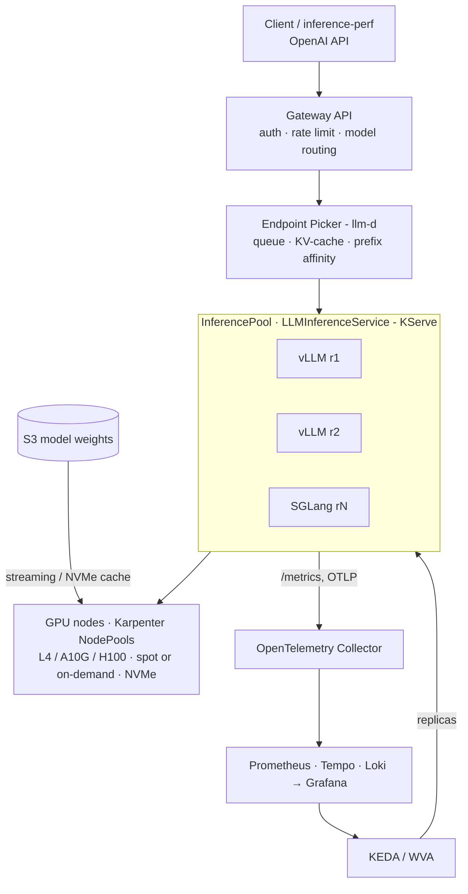

# AIBox — Product specification

> Source: Appendix A of `docs/agent/PLAYBOOK.md`, copied verbatim. Headings are promoted one level so this file stands alone.

## A.1 Vision and goals

A public repository that, with `make up PROFILE=aws-bench`, brings up an LLM inference platform on Kubernetes in about 25 minutes and publishes a benchmark report showing what each architecture decision costs. The product is not the cluster: it is the **evidence** that every component was chosen because of a number.

**Problem.** AI-native companies assemble LLM serving from loose parts (vLLM, a gateway, HPA on CPU, fixed GPU nodes) and do not know their cost per token or why p99 TTFT explodes under load. AIBox shows a reference path and measures the effect of each layer.

**Audience.** Hiring managers and Staff/Principal engineers evaluating AI infrastructure skills; platform engineers who want a reproducible starting point.

**What the repository must prove.**

1. End-to-end mastery: GPU node → runtime → routing → autoscaling → observability → cost.
2. Data-driven decisions: every ADR points to an experiment in the report.
3. Operability: one command up, one command down, nothing left billing.

**Success criteria (v1.0).**

| Criterion | Target |
| --- | --- |
| Bring-up from scratch (cloud profile) | ≤ 30 min, 1 command, no manual steps |
| Teardown | 1 command; 0 orphaned resources verified by script |
| Cost of a full benchmark round | ≤ USD 150 |
| Experiments in the report | ≥ 6, each with hypothesis, result and decision |
| Reproducibility | Another person reproduces an experiment within ≤ 10% on TTFT p50 |
| Local profile without GPU | Runs the full flow (with simulator) on a laptop |

## A.2 Scope

**In scope (v1.0):** AWS EKS single region (Terraform/OpenTofu); NVIDIA L4 (g6), A10G (g5), and one reference round on H100 (p5) reserved via EC2 Capacity Block; models Llama 3.1 8B Instruct (baseline), Qwen 32B (TP=2), one 70B-class quantized (FP8/AWQ); runtimes vLLM (primary) and SGLang (comparison), both OpenAI-compatible; Gateway API + Inference Extension (InferencePool + Endpoint Picker) via llm-d and KServe `LLMInferenceService`; KEDA on queue/KV-cache metrics and the llm-d Workload Variant Autoscaler (WVA); Karpenter GPU nodes with optional scale-to-zero; OpenTelemetry Collector, Prometheus, Tempo, Loki, Grafana, DCGM exporter; automated benchmark + versioned report.

**Out of scope:** training and fine-tuning; batch inference as a product; multi-cloud and multi-region; full multi-tenancy (quotas per tenant, billing) — v1 has API keys and simple rate limits; custom UI, model registry, model quality evaluation; production HA (mandatory multi-AZ, DR).

**v2 extensions (architecture must not prevent them):** prefill/decode disaggregation, KV-cache offload (LMCache), LoRA multiplexing, GKE profile, NVIDIA Dynamo runtime.

## A.3 Architecture



**Request path.** The client calls the OpenAI API on the Gateway; the gateway authenticates, rate-limits and asks the model's InferencePool EPP for an endpoint; the EPP scores pods by queue, KV-cache and prefix affinity; the vLLM pod runs prefill and decode and streams tokens.

**Control loop.** OTel collects `/metrics` from runtimes and EPP; KEDA reads queue and KV-cache from Prometheus and adjusts replicas; pending pods trigger Karpenter, which creates a GPU node; the new pod loads weights from S3 (or NVMe cache) and joins the pool only after warm-up.

Reference versions at spec time (pin the latest stable at implementation): KServe v0.18 integrates llm-d v0.6, migrates InferencePool to v1 and includes WVA with KEDA ([KServe 0.18 release](https://kserve.github.io/website/blog/kserve-0.18-release)). Prefix-cache aware routing showed ~3× output throughput and ~2× lower TTFT in a production report with Llama 3.1 70B ([source](https://terrytangyuan.github.io/2026/04/21/production-grade-llm-inference-at-scale-kserve-llm-d-vllm/)).

## A.4 Functional requirements

"Must" = required for v1.0; "may" = desirable.

### Layer 1 — Cluster and GPU nodes

| ID | Requirement |
| --- | --- |
| FR-INF-1 | Terraform must create VPC, EKS (latest supported), a CPU on-demand system node group, and IAM/Pod Identity for Karpenter, KEDA and the OTel collector. |
| FR-INF-2 | Karpenter must have one NodePool per GPU class (`gpu-l4`, `gpu-a10g`, `gpu-h100`) with taint `nvidia.com/gpu:NoSchedule`, family labels, and vCPU/GPU limits per pool. |
| FR-INF-3 | Pools must accept spot and on-demand; the choice is a profile parameter and a benchmark experiment. |
| FR-INF-4 | EC2NodeClass must use an NVIDIA-enabled AMI (Bottlerocket NVIDIA or AL2023 accelerated) and mount local NVMe for weight caching. |
| FR-INF-5 | NVIDIA GPU Operator (or device plugin + DCGM exporter when the AMI ships the driver) must expose `nvidia.com/gpu` and DCGM metrics. |
| FR-INF-6 | GPU pool consolidation must be `WhenEmpty` (avoid evicting pods with warm KV-cache) with configurable `consolidateAfter`. |
| FR-INF-7 | May support scale-to-zero of GPU pools, measuring end-to-end cold start. |

### Layer 2 — Model loading

| ID | Requirement |
| --- | --- |
| FR-MOD-1 | Weights must be mirrored once from Hugging Face to the environment's S3 bucket (`models sync` job), with checksums. |
| FR-MOD-2 | Pods must load weights by streaming (Run:ai Model Streamer or equivalent) or from local NVMe cache; the method is a cold-start experiment. |
| FR-MOD-3 | Declarative catalog `models/catalog.yaml`: id, source, revision (commit SHA), quantization, TP, `max-model-len`, minimum GPU class. |
| FR-MOD-4 | Hugging Face token must come from a Secret (External Secrets + AWS Secrets Manager), never from git. |

### Layer 3 — Inference runtime

| ID | Requirement |
| --- | --- |
| FR-RT-1 | vLLM must be the default runtime, image pinned by digest, flags declared in the catalog (prefix caching, chunked prefill, `gpu-memory-utilization`, `max-num-seqs`). |
| FR-RT-2 | SGLang must be selectable per model (`runtime: sglang`) with the same OpenAI-compatible interface. |
| FR-RT-3 | Every runtime must expose `/metrics`, `/health`, and readiness only after model load + a warm-up request. |
| FR-RT-4 | Graceful shutdown: `preStop` drains in-flight requests (configurable grace period). |
| FR-RT-5 | May support FP8 and AWQ quantization and FP8 KV-cache, each measured as an experiment. |

### Layer 4 — Routing and gateway

| ID | Requirement |
| --- | --- |
| FR-GW-1 | Single entry via Gateway API (implementation decided in ADR-0003) with OpenAI-compatible `/v1/chat/completions`, `/v1/completions`, `/v1/models`. |
| FR-GW-2 | Each model must be an InferencePool with the llm-d Endpoint Picker, with configurable scorers: queue, KV-cache usage, prefix-cache affinity. |
| FR-GW-3 | A naive routing mode (round-robin Service) must exist as the benchmark baseline, switchable without redeploying models. |
| FR-GW-4 | KServe `LLMInferenceService` must be the high-level per-model resource; a raw llm-d Helm path is documented and chosen in ADR-0002. |
| FR-GW-5 | API key authentication and per-key rate limits (requests/min and tokens/min) at the gateway. |
| FR-GW-6 | Routing by the `model` field of the request body to the right pool. |

### Layer 5 — Autoscaling

| ID | Requirement |
| --- | --- |
| FR-AS-1 | KEDA must scale replicas on runtime Prometheus metrics: queue (`vllm:num_requests_waiting`), KV-cache usage (`vllm:kv_cache_usage_perc`), and alternatively running concurrency. |
| FR-AS-2 | Policies declared per model (target, min/max replicas, stabilization window, cooldown) and versioned. |
| FR-AS-3 | A baseline CPU/GPU utilization HPA policy must exist to show in the benchmark why it fails for LLMs. |
| FR-AS-4 | Per-model scale-to-zero (KEDA `minReplicaCount: 0` + activation on queued requests) must be optional and measured (idle cost vs. first-request TTFT). |
| FR-AS-5 | Must integrate the llm-d Workload Variant Autoscaler (WVA) as a compared policy. |
| FR-AS-6 | The chain pending pod → Karpenter node → pod ready must be instrumented (timestamps per phase). |

### Layer 6 — Observability

| ID | Requirement |
| --- | --- |
| FR-OBS-1 | OpenTelemetry Collector (DaemonSet + gateway Deployment) collects metrics (Prometheus scrape), traces (OTLP) and logs. |
| FR-OBS-2 | Backends: Prometheus (kube-prometheus-stack), Tempo, Loki; Grafana dashboards provisioned as code. |
| FR-OBS-3 | Dashboards: SLO per model; capacity; GPU (DCGM); cost (USD/hour per pool, USD per 1M tokens live); scaling. |
| FR-OBS-4 | Per-request trace: gateway → EPP (routing decision + chosen endpoint) → runtime queue → prefill → decode. |
| FR-OBS-5 | Alerts as code: TTFT p99 SLO violation; KV-cache > 90% for 5 min. |
| FR-OBS-6 | Cost metric: price per instance (versioned table or pricing API) × node time ÷ generated tokens. |

## A.5 One-command experience

| Command | Behavior |
| --- | --- |
| `make up PROFILE=<p>` | Checks prerequisites and GPU quotas, runs Terraform, installs Argo CD, syncs app-of-apps, waits for Healthy, prints endpoint, API key and Grafana URL. |
| `make models-sync` | Mirrors catalog models to S3. |
| `make smoke` | One request per model + checks metrics, trace and dashboard. |
| `make bench EXP=<id>` | Runs one experiment and stores raw results + metadata. |
| `make report` | Generates the report from all results. |
| `make down` | Scales models to zero, removes Karpenter nodes, `terraform destroy`, runs the orphan checker. |
| `make cost` | Shows the session's accumulated cost. |

| Profile | Where | GPU | Use |
| --- | --- | --- | --- |
| `local` | kind on a laptop/CI | None; llm-d inference simulator or vLLM CPU with a tiny model | Development, CI, demos at zero cost |
| `aws-dev` | EKS | 1–2 L4 spot | Cheap iteration with 8B |
| `aws-bench` | EKS | L4, A10G and H100 (Capacity Block) per matrix | Official report runs |

**Cost guardrails (mandatory):** `BUDGET_USD` required, AWS Budget + TTL auto-teardown (default 4 h); Karpenter GPU limits; tags `project=aibox`, `run-id`, `owner`; orphan checker by tag; fail early on insufficient GPU quota.

## A.6 Benchmark and report

**Metrics:** TTFT p50/p95/p99; ITL/TPOT p50/p99; E2E p99; throughput (output tokens/s, requests/s); goodput (requests/s meeting TTFT and ITL SLOs); cost per 1M tokens (input and output); utilization (GPU SM %, memory, KV-cache %, prefix-cache hit rate); scale-out time by phase (node, image, weights, warm-up). Default SLO for the 8B model: TTFT p99 ≤ 1 s, ITL p99 ≤ 100 ms (per model in the catalog).

**Cost per 1M tokens** over the measured window (includes idle and headroom):

```text
cost_1M = ( Σ_nodes price_n × t_n ) / ( tokens_output + w × tokens_input ) × 10^6
```

Published for `w = 0` (per output token) and for a `w` calibrated by relative prefill time, plus the theoretical floor at 100% utilization.

**Workloads:** `chat-short`, `rag-long`, `summarize`, `agentic-multiturn`, `burst` (see feature 013). Load patterns: Poisson rate sweep to saturation; time profiles for autoscaling. Load generator: `inference-perf` as an in-cluster Job on a separate CPU node; spot cross-checks with `vllm bench serve` or GuideLLM.

**Experiment matrix (v1.0):**

| ID | Variable | Baseline → variants | Hypothesis |
| --- | --- | --- | --- |
| E1 | Routing | Round-robin → EPP (queue + KV) → EPP + prefix affinity | Prefix affinity lowers TTFT p99 on `rag-long` and `agentic-multiturn` |
| E2 | Autoscaling signal | HPA on GPU util → KEDA queue → KEDA KV-cache → WVA | Queue/KV signals hold the SLO on `burst` with fewer GPU-hours |
| E3 | Runtime | vLLM → SGLang, same model and GPU | Difference depends on workload; SGLang strong with shared prefixes |
| E4 | GPU class | L4 → A10G → H100 | A pricier GPU can have lower cost per 1M tokens near saturation |
| E5 | Quantization | BF16 → FP8 weights → FP8 KV-cache | FP8 raises throughput and lowers cost without breaking the SLO |
| E6 | Capacity type | On-demand → spot (simulated interruptions) | Spot lowers cost; measures interruption impact on errors and p99 |
| E7 | Cold start | HF download → S3 streaming → NVMe cache; scale-to-zero on/off | Streaming/cache cut scale-out from minutes to seconds |
| E8 | Runtime tuning | `max-num-seqs`, chunked prefill, `gpu-memory-utilization` | Shows the throughput × TTFT trade-off |

**Protocol:** 2 min warm-up discarded + 10 min measurement; 3 repetitions; median and range. Metadata recorded with every result (commit, image digests, driver/CUDA, instance type, AZ, capacity type, runtime flags, dataset hash). Raw results in `bench/results/<date>-<exp>/` (JSON + Parquet); never hand-edited.

**Report (`report/REPORT.md`):** executive decision table; per-experiment sections (hypothesis, config, latency × throughput curves, cost per 1M tokens at the SLO point, conclusion, ADR link); cumulative waterfall of cost per 1M tokens from naive baseline to final config; threats to validity; how to reproduce with exact commands and cost.

## A.7 Non-functional requirements

| ID | Area | Requirement |
| --- | --- | --- |
| NFR-1 | Reproducibility | Everything pinned: provider lock files, chart versions, image digests, model SHAs. Dependabot opens update PRs. |
| NFR-2 | Reproducibility | Benchmark results without full metadata are rejected by the report generator. |
| NFR-3 | Security | No credentials in git; Pod Identity with least privilege; secrets via External Secrets. |
| NFR-4 | Security | Restricted Pod Security where possible; default-deny NetworkPolicies per namespace; gateway is the only ingress. |
| NFR-5 | Security | Images scanned (Trivy) and SBOM generated in CI; Kyverno policy blocks images without digest. |
| NFR-6 | Cost | Budget and TTL guardrails; per-experiment cost estimate before running. |
| NFR-7 | Operability | Runbooks: GPU node does not come up, model fails to load (OOM), KV-cache saturated, spot interruption. |
| NFR-8 | Testing | CI on the `local` profile on every PR: lint, full deploy, smoke, metrics/traces arrive, KEDA scales with synthetic load. |
| NFR-9 | Testing | Manual workflow runs `aws-dev` + smoke + down to validate the cloud path; fails on orphans. Requires maintainer approval. |
| NFR-10 | Docs | README with diagram, 5-minute local quickstart, link to report; one ADR per significant decision. |
| NFR-11 | License | Apache-2.0; respect model licenses (Llama requires acceptance on HF). |

## A.8 Repository layout

```text
aibox/
├── Makefile
├── cmd/                      # aibox CLI and small tools (Go)
├── internal/                 # CLI packages
├── infra/
│   ├── terraform/aws/        # VPC, EKS, IAM, S3, budgets, TTL teardown
│   └── local/                # kind config
├── platform/                 # GitOps (Argo CD app-of-apps), Kustomize bases + overlays
│   ├── bootstrap/
│   ├── karpenter/
│   ├── gpu/
│   ├── gateway/
│   ├── serving/
│   ├── routing/
│   ├── autoscaling/
│   └── observability/
├── profiles/                 # local.yaml, aws-dev.yaml, aws-bench.yaml
├── models/catalog.yaml
├── metrics/runtime-metrics.yaml
├── schemas/                  # JSON Schemas (profile, catalog, results, metadata)
├── data/pricing/
├── bench/
│   ├── workloads/
│   ├── experiments/
│   ├── queries.yaml
│   └── results/
├── report/                   # Python generator + REPORT.md + charts
├── dashboards/               # Grafana JSON
├── test/                     # e2e and contract tests
├── docs/
│   ├── adr/
│   ├── runbooks/
│   ├── product/spec.md
│   └── agent/                # PLAYBOOK.md, PROGRESS.md
├── specs/                    # Spec Kit feature specs (NNN-short-name/)
└── .github/
```

## A.9 Decisions already taken (by the maintainer)

| Decision | Choice | Consequence |
| --- | --- | --- |
| CLI language | Go | Single binary (Cobra + client-go) via GoReleaser; the report generator may stay in Python, isolated in `report/`. |
| Metrics backend | Plain Prometheus (kube-prometheus-stack) | Short retention is enough; official benchmark results live as JSON/Parquet in git. |
| WVA in v1.0 | Included | FR-AS-5 is mandatory; E2 compares HPA, KEDA queue, KEDA KV-cache and WVA. |
| Top GPU of the matrix | H100 via EC2 Capacity Block | Predictable cost and guaranteed capacity; the window must be reserved ahead to match M5. |

## A.10 ADR index (planned)

| ADR | Topic | Decided by |
| --- | --- | --- |
| 0000 | Record architecture decisions | Feature 001 |
| 0001 | EKS + Karpenter as substrate (GKE in v2) | Feature 004 |
| 0002 | KServe `LLMInferenceService` vs raw llm-d Helm | Feature 008 |
| 0003 | Gateway implementation | Feature 009 |
| 0004 | Autoscaling signal | E2 |
| 0005 | Routing strategy | E1 |
| 0006 | Default GPU class and quantization | E4, E5 |
| 0007 | Weight loading and cold start | E7 |
| 0008 | CLI in Go with Cobra | Feature 002 |
| 0009 | GitOps with Argo CD app-of-apps | Feature 003 |
| 0010 | Mandatory budget and TTL for cloud runs | Feature 005 |
| 0011 | Prometheus as metrics backend | Feature 010 |
| 0012 | inference-perf as load generator | Feature 013 |
| 0013 | Report generator in Python | Feature 014 |
| 0014 | Documentation site tooling | Feature 016 |

## A.11 Risks

| Risk | Impact | Mitigation |
| --- | --- | --- |
| Low GPU quota (L4/H100) | Blocks M1+ cloud runs | Request quota in week 1; matrix runs on L4 if H100 is unavailable; H100 single round via Capacity Block |
| llm-d / Inference Extension APIs changing | Rework | Pin versions per milestone; isolate in `platform/gateway`, `platform/routing`, `platform/serving`; upgrade test in local CI |
| Benchmark cost overrun | Financial | Mandatory budget + TTL; per-experiment estimate; long runs on spot |
| Non-reproducible results | Report credibility | 3 repetitions, ranges in report, full metadata, load generator on a separate node |
| Model licenses | Legal | Default to permissive models (Qwen, Apache-2.0); Llama optional |
| Scope creep (P/D, LoRA, multi-cloud) | Delay | Keep in v2 list; every milestone has closed acceptance criteria |
